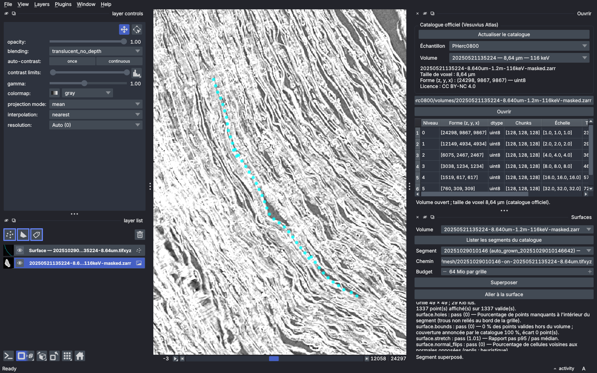
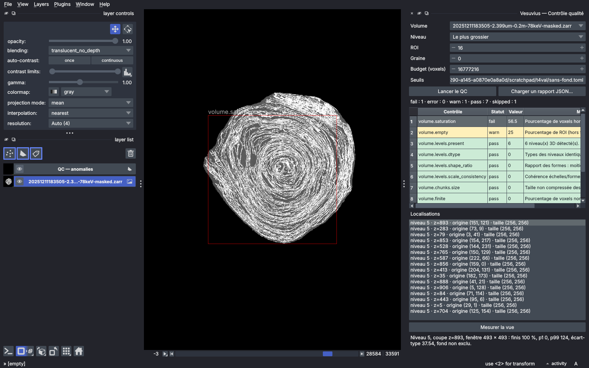

# Vesuvius Data Explorer

Outil libre développé par une équipe participante au **Vesuvius Challenge**. Nous l’utilisons pour vérifier où une surface segmentée suit la feuille de papyrus dans le scan. [Alignment map walkthrough (English)](docs/en/alignment-map.md) · [Validation sur des segments publiés](docs/validation/T10-carte-alignement.md) · [Contribuer](CONTRIBUTING.md)

Explorez les scans 3D des rouleaux d’Herculanum dans **napari**. L’explorateur lit les blocs OME-Zarr à la demande. Vous pouvez parcourir une coupe, superposer une surface VC3D et examiner une anomalie sans télécharger le volume entier. La commande `vesuvius-qc` permet de reproduire les contrôles et d’exporter leurs résultats.



Sur PHerc0800, la ligne de points cyan indique où le segment `20251029010146` traverse la coupe 12 058. En changeant de coupe, on peut suivre le segment à travers les couches du papyrus. [Voir le détail agrandi](docs/validation/t5-surface-pherc0800-zoom.png) · [Validation sur PHerc0800](docs/validation/T5-surfaces.md)

## Ouvrir un premier rouleau

Avec **Python 3.11 ou plus** et Git, créez un environnement virtuel.

```sh
python -m venv .venv
```

Activez-le avec `source .venv/bin/activate` sous Linux ou macOS, ou `.\.venv\Scripts\Activate.ps1` sous Windows PowerShell. Installez le plugin et lancez napari.

```sh
python -m pip install "vesuvius-data-explorer[napari] @ git+https://github.com/AtomCrtr/vesuvius-data-explorer-atom.git"
napari -w vesuvius-data-explorer
```

1. Dans **Vesuvius — Ouvrir un volume**, cliquez sur **Charger le catalogue officiel**, choisissez **PHerc0332** et son volume, puis cliquez sur **Ouvrir**.
2. Parcourez les coupes avec le curseur sous l’image. Le cache local réutilise les blocs déjà lus.
3. Dans **Plugins → Vesuvius — Contrôle qualité**, cliquez sur **Lancer le QC**, puis sélectionnez une anomalie et sa localisation pour centrer la vue sur la zone mesurée.

| Ouvrir une coupe depuis le catalogue | Examiner une alerte sur la coupe |
| --- | --- |
|  |  |
| Le volume sélectionné a un pas de **2,399 µm**. Le panneau liste les six niveaux de résolution disponibles. [Capture en grand](docs/validation/t6-contraste-pherc0332.png) | Dans cet essai, le calcul inclut le fond noir autour du rouleau. Le cadre montre pourquoi cette région déclenche l’alerte de saturation. [Détail du contrôle](docs/validation/T4-donnees-reelles.md) |

Pour travailler sur un serveur, installez le même paquet en retirant `[napari]`. Les volumes `*.vcd3d.zarr` nécessitent **Python 3.12 ou plus** et l’option `vcdelta3d`, par exemple `[napari,vcdelta3d]` avec l’interface graphique. [Guide d’utilisation et dépannage](docs/guide.md)

## Essayer la ligne de commande

**Contrôler un volume public.** Cette commande échantillonne PHerc0332 et écrit un rapport JSON ainsi qu’une version HTML à ouvrir dans un navigateur.

```sh
vesuvius-qc volume s3://vesuvius-challenge-open-data/PHerc0332/volumes/20251211183505-2.399um-0.2m-78keV-masked.zarr -o rapport.json --html rapport.html
```

Pour contrôler les segments d’un même volume, utilisez `vesuvius-qc lot 20250804134230 -o PHerc0814`. Le dépôt contient la synthèse obtenue sur ses 19 segments. [Résultats de PHerc0814](docs/validation/T7-qc-en-lot.md)

**Comparer deux cartes d’encre hors ligne.** Depuis la racine du dépôt cloné, après installation, générez deux fenêtres synthétiques puis lancez la comparaison dans un nouveau dossier de sortie.

```sh
python docs/examples/generate_ink_example.py data/encre-demo
vesuvius-qc encre data/encre-demo/manifest.toml -o data/encre-rapport
```

L’exemple permet d’examiner les accords et les erreurs des deux cartes sur des pixels dont la référence est connue. Pour des prédictions déjà calculées sur une même surface, napari propose aussi un panneau de comparaison interactif. [Exemple de comparaison synthétique](docs/validation/ink-synthetic/comparaison-001.png) · [Comparer des prédictions dans napari](docs/COMPARAISON_PREDICTIONS.md)

## Se repérer dans le dépôt

| Pour… | Point d’entrée |
| --- | --- |
| Utiliser le plugin ou automatiser un contrôle | [Guide illustré](docs/guide.md) · [Référence CLI et API](docs/reference.md) |
| Retrouver un protocole, un benchmark ou une campagne sur données réelles | [Index de la documentation](docs/README.md) · [Exemples de rapports](docs/examples/README.md) |
| Modifier l’explorateur | [Code Python](src/vesuvius_data_explorer/) · [Extension Rust facultative](rust/) · [Tests](tests/) · [Contribuer](CONTRIBUTING.md) |
| Suivre les travaux en cours | [Feuille de route du projet](docs/ROADMAP.md) · [Prochaines étapes scientifiques](docs/ROADMAP_SCIENTIFIC_NEXT_STEPS.md) |

## Données et licence

Le projet est maintenu indépendamment des organisateurs. La licence MIT autorise l’utilisation, la modification et la redistribution du logiciel, y compris à des fins commerciales. Les copies du logiciel ou de portions substantielles doivent conserver la notice de copyright et de permission. [Licence MIT du projet](LICENSE)

Les trois captures ci-dessus utilisent des extraits de **Vesuvius Challenge – CT Scans of Herculaneum Papyri**, acquisitions PHerc0800 et PHerc0332, sous CC BY-NC 4.0. Les autres scans, annotations et poids de modèles ont leurs propres conditions. Pour citer un résultat, indiquez le jeu d’origine, l’acquisition et la version du code. Les fragments historiques EduceLab-Scrolls ont une citation spécifique. [Licence des captures](https://creativecommons.org/licenses/by-nc/4.0/) · [Citations et licences par jeu de données](https://scrollprize.org/data#how-to-cite) · [Outils officiels](https://github.com/ScrollPrize/villa)
