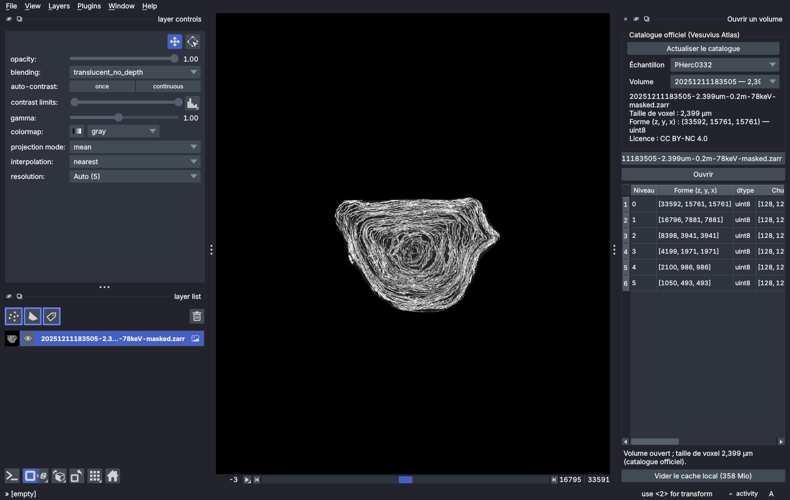

# 📜 Vesuvius Data Explorer

**Explorer et contrôler la qualité des scans 3D des rouleaux d'Herculanum, dans napari ou en ligne de
commande, sans télécharger les volumes en entier.**

> Projet communautaire indépendant, ni affilié au [Vesuvius Challenge](https://scrollprize.org) ni
> approuvé par lui. Ce n'est pas un outil de déroulement virtuel ni de détection d'encre.


<sub>Extrait des données PHerc0332, Vesuvius Challenge, CC BY-NC 4.0.</sub>

## Ce que fait l'outil

| Besoin | Réponse |
|---|---|
| Ouvrir un scan publié | Choix dans le **catalogue officiel** (échantillon → volume, taille de voxel en µm) ou chemin local / S3 / HTTPS |
| Naviguer vite | Lecture des seuls blocs affichés, **cache local** : la coupe suivante s'affiche en 0,2 s |
| Contrôler un volume | Saturation, zones vides, contraste, cohérence des niveaux ; **anomalies dessinées sur l'image** |
| Contrôler une surface VC3D | Trace sur la coupe, **trous**, replis, étirement, points hors volume, **alignement sur la feuille de papyrus** |
| Contrôler tous les segments d'un volume | Une commande, une synthèse HTML / CSV / JSON |
| Savoir où une surface quitte sa feuille | **Carte d'alignement** tuile par tuile, zones à revoir, **recalage** sur demande (`vesuvius-qc carte`) |

## Installation

Python **3.11 ou plus**. Dans un terminal :

```bash
python -m venv .venv
source .venv/bin/activate          # Windows : .venv\Scripts\activate
pip install "vesuvius-data-explorer[napari] @ git+https://github.com/AtomCrtr/vesuvius-data-explorer-atom.git"
```

- Sans interface graphique (serveur, calcul) : retirer `[napari]`.
- Volumes récents au format `*.vcd3d.zarr` : ajouter l'option `vcdelta3d` (Python 3.12 ou plus), par
  exemple `[napari,vcdelta3d]`.
- Pour contribuer : `git clone` du dépôt puis `pip install -e ".[napari,dev]"`.

## Démarrer

**Dans napari :**

```bash
napari -w vesuvius-data-explorer
```

1. Dans **Vesuvius — Ouvrir un volume**, cliquer sur **Charger le catalogue officiel**, choisir un
   échantillon puis un volume, et cliquer sur **Ouvrir**.
2. Menu **Plugins → Vesuvius — Contrôle qualité** : **Lancer le QC**, puis cliquer sur une anomalie
   pour y aller.
3. Menu **Plugins → Vesuvius — Surfaces** : **Lister les segments du catalogue**, **Superposer**, puis
   **Mesurer l'alignement**.

**En ligne de commande :**

```bash
vesuvius-qc volume s3://vesuvius-challenge-open-data/PHerc0332/volumes/20251211183505-2.399um-0.2m-78keV-masked.zarr -o rapport.json --html rapport.html
vesuvius-qc lot 20250804134230 -o PHerc0814/      # tous les segments d'un volume du catalogue
```

Le [guide d'utilisation](docs/guide.md) détaille chaque étape, avec des captures.

## Bon à savoir

- **Codes de sortie** de `vesuvius-qc` : 0 si tout passe (avertissements compris), 1 si un contrôle
  échoue, 2 si l'entrée est invalide.
- **Cache local** : `~/.cache/vesuvius-data-explorer/`, 10 Gio au plus, bouton pour le vider ;
  `VESUVIUS_CACHE=0` le désactive.
- **Seuils** : provisoires, réglables par un fichier TOML (`--config`). Chaque seuil a été calibré sur
  des données réelles (voir `docs/validation/`).
- **Limites** : un segment décalé d'une feuille entière n'est pas détectable ; la première vue d'une
  région jamais lue dépend du réseau (environ 3 s).

## Documentation

- [Guide d'utilisation](docs/guide.md) : pas à pas, dépannage.
- [Référence technique](docs/reference.md) : comportement détaillé, formats, API Python, tests.
- [Feuille de route](docs/ROADMAP.md) : tâches, décisions, validations sur données réelles.
- [Alignment map (English)](docs/en/alignment-map.md) : carte d'alignement et recalage des
  segments (T10).

## Données et licence

- Code sous **licence MIT**. Elle ne s'applique pas aux données.
- Les scans du Vesuvius Challenge sont sous **CC BY-NC 4.0** sauf mention contraire. Citer le jeu de
  données d'origine exact pour tout résultat publié, selon les
  [consignes officielles](https://scrollprize.org/data). Les captures de `docs/` contiennent des
  extraits de ces données, attribués dans chaque rapport de validation.
- Outils officiels de l'écosystème : [villa / VC3D](https://github.com/ScrollPrize/villa),
  [vesuvius-gui](https://github.com/ScrollPrize/vesuvius-gui).
