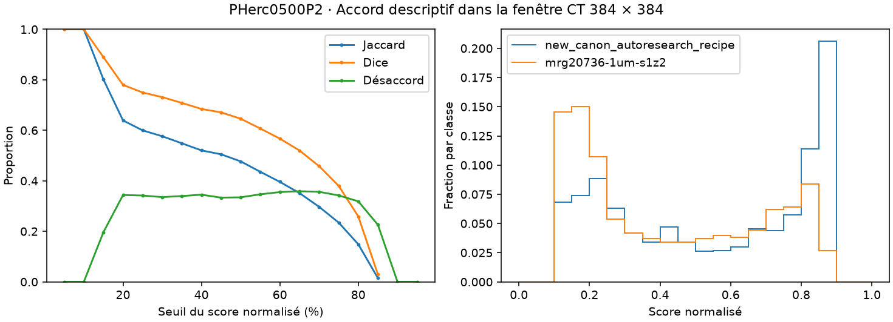

# Accord descriptif entre cartes d’encre

Le recadrage CT PHerc0500P2 comprend 147 456 pixels dans la fenêtre
`[388,772[ × [508,892[` ([V,U], pixel 2,215 µm). Les deux TIFF et le CT
partagent cette fenêtre. L’accord à 50 % vaut 0,477 en Jaccard et 0,646
en Dice. Au rang 1 %, les cartes n’ont aucun pixel en commun, y compris
sur la surface entière. Les deux résultats décrivent des règles de
sélection différentes. [Audit des cartes](INK_PROVENANCE_AUDIT.md) · [Mesures de fenêtre](validation/phase5-consensus-windows.json)



## Utilisation dans napari

Ouvrir `data/phase4-ink/comparison-phase5.json` dans **Comparer les
prédictions**. Sélectionner A et B, régler le seuil, puis délimiter une
région pour **Accord par seuil et distributions**. Le panneau affiche
la superposition, les zones **A seule** et **B seule**, l’intersection
et les régions proches du seuil ou manquantes. La fenêtre d’accord
donne les positions V/U, les identifiants de modèles et trois vues pour
les seuils, les rangs et les distributions. Avec plus de deux cartes,
le panneau permet de changer de paire. `analyze_comparison` appelle
le même calcul sur chaque paire unique du manifeste.

Pour chaque modèle, le seuil est un pourcentage du diviseur déclaré
(`score_scale`, 255 ici). La décision positive inclut les égalités au
seuil. Jaccard vaut intersection/union, Dice vaut deux fois l’intersection
divisée par le total des deux nombres positifs, et désaccord vaut
A seule plus B seule, divisé par le nombre de pixels appariés.
Les valeurs manquantes sont comptées séparément, et une union vide
donne un Jaccard et un Dice indéfinis. Le mode incertitude marque en
jaune les scores à ±5 points de pourcentage du seuil pour au moins une
carte et en violet les pixels manquants. Cet intervalle mesure la
sensibilité au seuil choisi.

La carte de différence historique reste disponible comme différence
de scores normalisés. Le libellé probabiliste et les agrégats d’écart
de probabilité nécessitent deux déclarations de calibration pour le
même événement et la même grille, révision et face documentées. Le
manifeste vérifie la cohérence de ces déclarations et le tag
d’orientation TIFF. La qualité de la calibration dépend de la preuve
citée. Sur PHerc0500P2, les agrégats de probabilité sont absents.

## Seuils et stratégies

| Seuil du score | A seule | B seule | Intersection | Union | Jaccard | Dice | Désaccord |
|---:|---:|---:|---:|---:|---:|---:|---:|
| 35 % | 37 043 | 13 066 | 60 926 | 111 035 | 0,549 | 0,709 | 34,0 % |
| 50 % | 35 941 | 13 428 | 45 060 | 94 429 | 0,477 | 0,646 | 33,5 % |
| 65 % | 40 114 | 12 808 | 28 697 | 81 619 | 0,352 | 0,520 | 35,9 % |
| 80 % | 38 934 | 8 082 | 8 225 | 55 241 | 0,149 | 0,259 | 31,9 % |

À 50 %, l’intersection conserve 45 060 pixels sur les 81 001 de A
et les 58 488 de B. Elle réduit la surface à relire de 44,4 % par
rapport à A et de 23,0 % par rapport à B. L’union couvre 94 429 pixels
et élargit la recherche. L’intersection privilégie la concordance
et peut perdre des traces visibles dans une seule carte. Sans
annotations indépendantes sur cette grille, on ne connaît pas le
nombre de vrais ou de faux positifs éliminés.

Pour éviter de présumer des échelles équivalentes, le rang est calculé
sur les scores de chaque carte. Tous les ex æquo à la coupure sont
retenus. Sur les 790 200 pixels de code non nul communs de la surface
entière, le top 1 % retient ainsi 9 865 pixels pour A et 9 089 pour B
(coupures 236 et 214). Leur intersection est vide. À 5 %, elle est de
2 860 pixels, Jaccard 0,035. À 20 %, elle est de 78 000 pixels,
Jaccard 0,325. Le résultat à 1 % confirme l’observation publique
malgré une règle d’ex æquo explicite. Les rangs de la fenêtre, calculés
sur ses pixels finis, figurent à part dans les mesures.
[Résultats sur le support entier](validation/phase5-provenance-windows.json) · [Discussion publique](https://github.com/ScrollPrize/villa/issues/1377)

## Galerie et export

**Ajouter** associe un libellé, les coordonnées et les modèles
affichés à la région. **Documenter** recueille l’observation, une
hypothèse éventuelle, la confiance qualitative et le commentaire
paléographique. **Galerie des observations** affiche le CT, la
surface UV et les cartes sélectionnées. Les vignettes CT et surface
utilisent un contraste local, les scores utilisent le diviseur du
manifeste. **Ouvrir** recentre la vue sur la fenêtre enregistrée.

La session JSON et le PNG conservent l’origine inclusive, la borne
exclusive, les coordonnées en µm, le manifeste et les empreintes
des sources. Le statut « validation externe documentée » consigne
le nom d’une personne et une référence indépendante saisis par
le lecteur. La galerie ne valide aucun caractère automatiquement.
Les anciennes sessions restent lisibles. [Fenêtres de référence à relire](INK_EVALUATION_DATASET.md#fenêtres-et-relecture)

## Reproduction locale

```powershell
$env:QT_QPA_PLATFORM = 'windows'
$env:LOCALAPPDATA = Join-Path $PWD 'data/phase5-appdata-bench'
$env:MPLCONFIGDIR = Join-Path $PWD 'data/phase5-mplconfig'
.venv/Scripts/python.exe docs/validation/phase5_consensus.py data/phase4-ink/comparison-phase5.json docs/validation/phase5-consensus-windows.json --napari --plot docs/validation/phase5-consensus-curves.png
```

`--napari` mesure l’affichage natif et `--plot` utilise Matplotlib.
Le calcul et les mesures se font sur les fichiers locaux.
[Préparation du manifeste](INK_PROVENANCE_AUDIT.md#reproduction)
