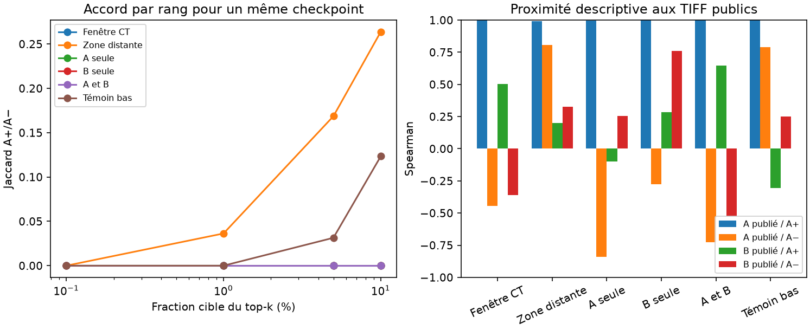

# Phase 7 · Accord des cartes et effets mesurables

Sur la fenêtre CT de 147 456 pixels, A+ retrouve le classement
du TIFF A publié avec un Spearman de **0,9999**. Reconverti sur
255 entiers comme le TIFF, A+ est identique sur 88,53 % de cette
fenêtre et à **un code au maximum** sur les autres pixels.
Ces résultats rapprochent fortement le protocole local du
rendu de A. L’empreinte des poids de production reste inconnue.
[Mesures par domaine](validation/phase7-model-comparison.json)

| Domaine | Spearman A+/A− | Jaccard top 1 % | Jaccard top 5 % | Jaccard top 10 % | Écart absolu A+/A− |
|---|---:|---:|---:|---:|---:|
| Fenêtre CT | −0,444 | 0 | 0 | 0 | 0,415 |
| Zone distante | 0,809 | 0,036 | 0,169 | 0,264 | 0,780 |
| Candidat A seule | −0,840 | 0 | 0 | 0 | 0,733 |
| Candidat B seule | −0,275 | 0 | 0 | 0 | 0,489 |
| Candidat A et B | −0,727 | 0 | 0 | 0 | 0,629 |
| Témoin bas | 0,789 | 0 | 0,031 | 0,123 | 0,090 |

Le top 0,1 % est disjoint dans les six domaines. En fenêtre CT,
A+ s’étend de 0,125 à 0,897 et A− de 0,118 à 0,178.
Le seuil commun à 20 % ne sélectionne donc aucun pixel A−.
C’est aussi le cas à 35, 50, 65 et 80 %. Le Jaccard et le
Dice valent zéro si A+ sélectionne des pixels. Une union vide,
par exemple à 50 % sur le témoin bas, est rapportée comme
indéfinie. Les rangs montrent que la compression des amplitudes
n’explique pas seule le résultat. Les valeurs au centre du stack,
les contrastes en profondeur et les rangs varient selon le secteur.

## Ce que l’expérience permet d’attribuer

Pour des poids fixes, changer seulement l’ordre Z suffit à
créer une séparation des rangs au moins aussi nette que celle
observée entre les TIFF dans la fenêtre CT. La zone distante
conserve un accord de rang partiel et un Spearman positif.
La proximité du TIFF B à A− par rapport à A+ change de signe
selon la région. Elle augmente dans le candidat B seule
(0,759 contre 0,285) et diminue sur la fenêtre CT entière
(−0,360 contre 0,502). L’ordre Z est donc un facteur mesuré
plausible dans le désaccord de production. Sa part quantitative
et l’interaction avec l’architecture B restent à mesurer.

Les TIFF publiés entrent uniquement dans une comparaison
descriptive sur les pixels co-localisés. Aucun TIFF ne remplit
une cellule B+/B−. Si les quatre cellules sont disponibles, le
code produit les six contrastes et calcule l’interaction
\((r_{A+}-r_{A-})-(r_{B+}-r_{B-})\) avec les rangs moyens
normalisés dans chaque condition sur le support partagé.
Cette définition compare les déplacements de rang et ne suppose
pas une calibration commune des amplitudes.

## Conventions et contrôles

Le rapport donne Pearson et Spearman à rang moyen, effectifs et
matrices de seuil, Jaccard/Dice, distributions sur 20 classes et
top 0,1 %, 1 %, 5 %, 10 %. Les ex æquo sont inclus. Les
NaN, infinis et pixels masqués sont exclus avant tout classement.
Les tests couvrent aussi ces cas sans variation de l’échelle
d’un modèle à l’autre. Les seuils sont des proportions du
diviseur déclaré, 255 pour les TIFF et 1 pour les sorties du
checkpoint. Les comparaisons sont effectuées sur le masque
CT/Hann ainsi que sur son intersection avec le support non nul
des TIFF. Dans les fenêtres retenues ces supports coïncident.
Le test d’assemblage vérifie les pixels non couverts. Toutes les
mesures concernent l’accord. Les références EduceLab ne
permettent toujours pas de mesurer la performance de généralisation
des checkpoints de PHerc0500P2.
[Audit EduceLab](EDUCELAB_INDEPENDENCE_AUDIT.md)
