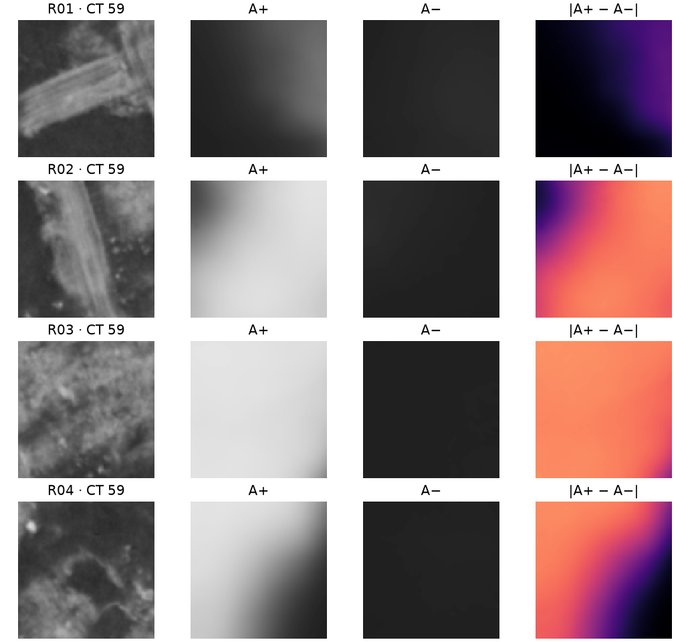

# Relecture des quatre régions de PHerc0500P2

Le script vérifie l’empreinte du dossier de phase 7, ses membres et les coordonnées de chaque ROI. Le CT59 et les scores A+/A− des quatre recadrages correspondent pixel pour pixel à la carte réassemblée de la phase 8. Toutes les ROI font 128² pixels et couvrent du CT valide à 100 %. Elles appartiennent au rendu de 2,215 µm du segment `20250919184428`. Les bornes V,U sont à base zéro et la borne de fin est exclue. [Coordonnées, notes originales, statistiques et empreintes](validation/phase8-review-windows.json)

| Région | Début → fin V,U | Moyenne `abs(A+ − A−)` [intervalle 95 %, blocs 32²] | Spearman | État |
| --- | --- | --- | ---: | --- |
| R01 | 516,508 → 644,636 | 0,090 [0,049 ; 0,135] | 0,789 | Encre indéterminée |
| R02 | 644,636 → 772,764 | 0,629 [0,549 ; 0,686] | −0,727 | Encre indéterminée |
| R03 | 516,764 → 644,892 | 0,733 [0,714 ; 0,748] | −0,840 | Encre indéterminée |
| R04 | 644,764 → 772,892 | 0,489 [0,375 ; 0,605] | −0,275 | Encre indéterminée |

- **R01.** Des lignes claires parallèles forment un faisceau oblique qui rejoint une structure transverse. Les scores restent bas dans les deux orientations. C’est le témoin de faible réponse. Une relecture à travers les coupes peut confirmer la continuité du faisceau avec les fibres voisines.
- **R02.** Une bande claire, légèrement inclinée par rapport à la verticale, traverse le CT59. A+ s’étend latéralement au-delà de la bande et A− reste bas. Le gradient peut accompagner un faisceau ou une limite de couche. Priorité à un contrôle multi-coupes et à une comparaison avec un champ optique de la même lamelle s’il existe.
- **R03.** Le CT présente une texture granulaire et de faibles lignes obliques. A+ forme un plateau large qui dépasse les structures nettes de la coupe. A− répond faiblement sur la même étendue. L’hypothèse de texture ou de superposition de couches mérite un examen au même contraste, ainsi qu’un contrôle optique autour du bord du plateau.
- **R04.** Des arcs clairs délimitent des zones plus sombres et un point lumineux apparaît en haut à gauche. Le gradient A+ traverse la fenêtre. La carte B de production avait une réponse diffuse dans ce secteur. Rechercher une frontière de couche, un vide ou un pli en profondeur, puis vérifier la face et la coïncidence optique avant toute interprétation de la réponse.

Pour une première relecture, R02 et R04 présentent des géométries différentes. R03 contrôle une forte variation d’orientation et R01 fournit un témoin de faible score. Aucun caractère n’est attribué. Pour les quatre cas, l’interprétation d’encre exige une référence optique ou IR recalée avec face et erreur documentées. [Protocole de validation](PHASE8_INK_VALIDATION.md)

## Exports et navigation

1. Ouvrir d’abord [l’archive de relecture CT](../data/phase8/CT-relecture-neutre-phase8.zip). Elle contient les cubes de 62 coupes `[28,90)` en intensités 8 bits du rendu original, le CT59, les masques, les positions et les empreintes. Relever les observations CT par identifiant R01–R04. La position est conservée pour le contrôle des sources et permet à un lecteur connaissant l’Atlas de retrouver la zone.
2. Après la lecture CT, ouvrir [le dossier annoté avec scores](../data/phase8/examen-Z-phase8.zip). Il conserve les TIFF de production en contexte, le couple A+/A−, les réglages de comparaison et les quatre fiches. Après extraction, ouvrir le fichier `session.json` référencé dans son index depuis le panneau de comparaison.
3. Charger [la session de surface entière](../data/phase8/surface/session.json) pour circuler entre les 61 cellules analysées. Dans napari, utiliser **Reprendre une session**, puis **Galerie des observations** ou la liste **Candidats à valider**. Les cellules mesurées sont repérées par leur origine, leur écart moyen et leur couverture. Le statut scientifique et les notes passent dans les exports.
4. **Superposer la sensibilité Z sur le CT** sélectionne la paire attestée et le CT comme fond. **Superposition** montre directement les deux cartes avec couleurs et opacité distinctes. **Accord par seuil et distributions** calcule les mesures sur la ROI, affiche l’intervalle spatial, la révision et la source. Les commandes d’export PNG et d’examen conservent les coordonnées, les réglages, la provenance et le statut des annotations selon le format.

Les deux archives restent locales. La référence des cubes est Vesuvius Challenge Open Data. [Conditions et attribution](https://github.com/ScrollPrize/open-data#support-and-citation)
