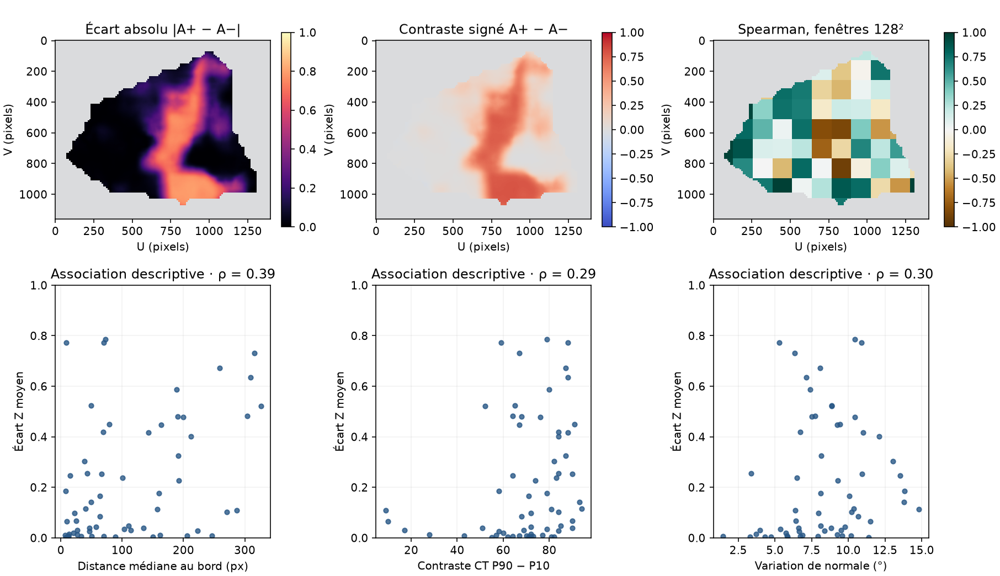

# Robustesse spatiale de l’effet Z

L’inversion des coupes du checkpoint A change fortement ses scores sur le rendu historique de PHerc0500P2. Le changement persiste à l’intérieur du support CT et varie fortement d’une zone à l’autre. La couverture et la distance au bord présentent les associations régionales les plus fortes parmi les indicateurs mesurés. Le mécanisme qui produit ces écarts reste indéterminé.

## Plan et support

La grille du segment `20250919184428` a 1 160 lignes V et 1 400 colonnes U. Les coordonnées début-fin sont des indices à base zéro, borne haute exclue. Le plan découpe toute la grille en cellules disjointes de 128 × 128 pixels, avec restes aux bords. Une cellule entre dans l’analyse si ses deux dimensions atteignent 64 pixels et si elle contient au moins 1 024 pixels valides dans les deux orientations. La grille et le filtre reposent sur la géométrie et le CT. Sur 110 cellules, 61 sont analysées et 49 restent tracées avec leur motif d’exclusion.

Pour A+ et A−, les entrées utilisent les mêmes coupes `[28,90)`, le même poids, la même échelle CT, les mêmes tuiles 256 × 256 au pas de 128 et le même assemblage à poids de Hann. A− inverse l’axe profondeur à l’entrée. La validité combine au moins un voxel CT non nul dans la pile d’entrée et un poids d’assemblage positif. Les pixels hors support du rendu restent masqués dans les métriques et les cartes. Le recadrage historique `V[388,772) U[508,892)` restitue les deux cartes et le CT59 de la phase 7 bit à bit. [Plan des entrées](validation/phase8-input-plan.json) · [Protocole CUDA](recherche/phase-08/VESUVIUS_PHASE8.md#reproduction)

## Résultats

| Support | Pixels appariés | Pearson | Spearman | Moyenne de `abs(A+ − A−)` | Intervalle à 95 %, blocs 64² |
| --- | ---: | ---: | ---: | ---: | --- |
| Tous les pixels valides | 790 200 | −0,016 | 0,021 | 0,247 | [0,209 ; 0,283] |
| Intérieur à plus de 16 pixels du bord | 725 316 | 0,010 | 0,039 | 0,255 | [0,218 ; 0,292] |
| Bande de bord jusqu’à 16 pixels | 64 884 | −0,012 | 0,074 | 0,157 | [0,107 ; 0,214] |

Le support valide couvre 48,66 % du rectangle. En forçant les pixels hors support à zéro pour les deux cartes, Pearson monterait à 0,695 et Spearman à 0,870. Cette manipulation sert de contrôle du biais de fond. Sur le support valide, l’écart signé moyen A+ − A− est +0,245. Les variances A+ et A− sont 0,07384 et 0,000274 et les entropies sur 20 classes fixes atteignent respectivement 3,592 et 0,566 bits.

Au seuil fixe de 20 %, le Jaccard positif est 0,0204 et le Dice 0,0400. Aux seuils de 35, 50, 65 et 80 %, aucun pixel positif n’est commun et A− reste intégralement sous ces seuils. Les top 0,1 %, 1 % et 5 % globaux sont disjoints. Au top 10 %, 3 005 pixels se recouvrent sur 79 020 sélectionnés par carte, pour un Jaccard de 0,0194. La sélection par rang conserve les ex æquo au seuil et les compte dans la taille réelle.

Les moyennes régionales d’écart absolu s’étendent de 0,003 (V768–U0, couverture de 6,93 %, Spearman 0,938) à 0,786 (V896–U768, couverture complète, Spearman 0,856). Une bonne concordance de rang peut donc coexister avec un changement important d’amplitude. Dans 34 des 61 cellules, l’écart-type des scores A− est inférieur à 0,005. Pour les zones sans variation, les corrélations indéfinies sont encodées par `null`. Le fichier de mesures enregistre aussi le maximum de la fraction du top 5 % contenue dans un bloc de 16 × 16 pixels, les histogrammes par carte et la proportion valide par ROI.

## Facteurs observés

| Indicateur par cellule | Spearman avec l’écart absolu moyen | Cellules |
| --- | ---: | ---: |
| Fraction du rectangle dans le support | 0,396 | 61 |
| Distance médiane au bord du support | 0,388 | 61 |
| Angle entre normales TIFXYZ voisines | 0,296 | 60 |
| Contraste CT59 P90−P10 | 0,290 | 61 |
| Écart absolu CT59 entre voisins | 0,168 | 61 |
| Différence signée des deux moitiés CT en profondeur | −0,175 | 61 |
| Écart absolu CT entre coupes CT en miroir | −0,042 | 61 |

L’écart augmente dans des fenêtres plus remplies et plus intérieures. L’analyse de la bande de bord confirme que la sensibilité existe aussi loin du bord. La courbure locale est approchée par des angles entre normales sur la grille TIFXYZ décimée. Elle n’est disponible que sur une fraction médiane de 0,337 des pixels par cellule. Tous les pixels appariés des cellules admises ont un support d’interpolation TIFXYZ valide et aucun profil CT entièrement nul. Ces indicateurs n’offrent donc pas de variation avec laquelle tester les trous de coordonnées ou le remplissage CT. Des traces de fibres, de strates ou de fissures locales peuvent affecter le modèle, mais les covariables CT testées soutiennent faiblement cette piste. L’analyse est marginale, les covariables et cellules voisines sont dépendantes et un seul segment a été mesuré.

Les intervalles rééchantillonnent des blocs non vides, dans chaque ROI, avec 499 tirages et une graine fixe. L’intervalle global pour 32² est [0,227 ; 0,265] sur 832 blocs, et pour 64² [0,209 ; 0,283] sur 228 blocs. Les petites régions peuvent avoir moins de quatre blocs de taille donnée. Leurs intervalles sont alors omis. Ces intervalles décrivent la sensibilité interne du résumé au découpage spatial. L’assemblage utilise des tuiles qui se recouvrent et des dépendances plus longues que 64 pixels peuvent subsister.

[Mesures brutes et règles de sélection](validation/phase8-spatial-windows.json) · [Script d’analyse](validation/phase8_spatial.py)
