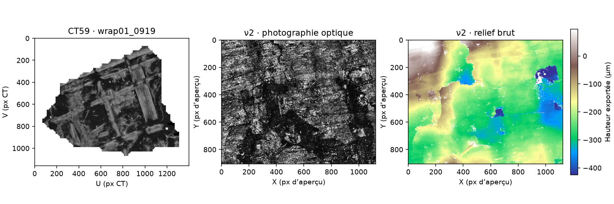

# Recalage CT–optique de PHerc0500P2

La localisation de ν2 reste indéterminée. Le maillage frontal publié et `wrap01_0919` couvrent deux géométries séparées dans le même volume CT. Le fragment est identifié et la surface frontale fournit une piste de localisation. Il manque une correspondance entre le champ du profilomètre et cette surface. [Rapport géométrique](validation/phase9-localization.json)

## Cadres et provenance

| Élément | Identification et état |
| --- | --- |
| Champ optique | `500P2_230925_N2`, PHerc. 500P2, cassetto 28, 23 septembre 2025. Relief et photo en coordonnées locales instrumentales XY. |
| Volume cible | Atlas `20250526151718`, 2,215 µm par voxel, 111 keV, 0,4 m. Les coordonnées TIFXYZ sont des voxels L0 dans ce volume. |
| Surface frontale candidate | `20250628074500-500P2_front`. L’Atlas fournit un TIFXYZ historique, une révision t2, et un rendu ZVU de 118 × 26 440 × 15 060 sur l’acquisition cible. |
| Surface avec scores A± de phase 8 | `20250919184428-0500P2-wrap01_0919`. Le rendu historique est de 118 × 1 160 × 1 400. L’augmentation de l’indice de profondeur suit `−N` aux dix témoins CT des phases 7 et 8. |
| Source photographique de situation | L’Atlas expose un JPEG de 352 × 574 pixels du fragment. Le préprint montre un composite CT frontal et le cliché IR de Naples M1050 n° 017 déjà déformé vers ce composite. |

L’Atlas inventorie 46 surfaces sur le spécimen. Les dossiers publics de la surface frontale contiennent des maillages, des rendus et des scores d’encre. Le préprint décrit un recalage par points de contrôle manuels sur la figure étendue 5, avec un champ de 35,8 × 58,1 mm. Le rectangle du rendu Zarr frontal de l’Atlas couvre nominalement 33,36 × 58,56 mm. La correspondance pixel à pixel entre ce Zarr et le composite de la figure reste indéterminée. Ni les sources consultées ni les métadonnées optiques ne relient les quatre identifiants de champ à des points ou des polygones sur le cliché n° 017 ou dans l’Atlas. Les transformations entre acquisitions CT ne donnent que des correspondances entre volumes de tomographie. [Préprint v1, figure étendue 5](https://arxiv.org/html/2606.29085v1#Sx12.F5) · [Catalogue public](https://scrollprize.org/data_browser)

## Contrôles réalisés

Le maillage frontal a été comparé aux 2 181 nœuds valides du TIFXYZ historique de `wrap01_0919`, en voxels XYZ physiques ramenés au même volume. La distance au nœud frontal le plus proche est de 4,421 à 5,055 mm, médiane 4,655 mm. Avec la révision t2 du frontal, elle est de 4,427 à 5,066 mm, médiane 4,661 mm. Les médianes R02 et R04 sont de 4,634 mm et 4,549 mm dans la première révision. Ces écarts dépassent largement le pas des maillages frontaux de 44,3 µm et 86,3 µm. Les écarts signés le long de la normale frontale locale restent positifs aux nœuds sondés. La distance décrit les points échantillonnés et le signe leur normale locale. Elle ne qualifie pas le recto ou le verso de `wrap01_0919`.

La diagonale XY complète de ν2 vaut 3,975 mm d’après le fichier numérique et 1,965 mm avec le pas indiqué dans l’article. Le diamètre 3D des nœuds valides de `wrap01_0919` vaut 2,723 mm. Le champ entier ne pourrait donc pas tenir sur ces nœuds par mouvement rigide au premier pas. Un recouvrement partiel reste géométriquement possible et la deuxième hypothèse d’échelle lève cette objection dimensionnelle. La projection UV nominale seule donne un rectangle plus grand que le support 3D réellement tracé.

En complément, le pilote a recherché des signatures structurales par corrélation normalisée entre les gradients du relief brut et ceux du **panneau CT** de la figure publiée. Ni les annotations, ni la photo d’encre, ni les scores A n’ont servi à cette recherche. La barre de 5 mm donne un pas d’aperçu proche de 88 µm. À cette échelle, ν2 ne couvre que 28 × 35 pixels ou 14 × 17 pixels selon le pas optique. Les translations et huit combinaisons de quarts de tour et de miroir ont été testées sous les deux hypothèses d’échelle, avec des blocs sans recouvrement entre calcul des candidats et diagnostic réservé. Au pas de l’export, les deux premières corrélations valent 0,552 et 0,544 dans deux lieux différents. Le contrôle réservé donne 0,266 et 0,304. Au pas de l’article, les deux premières valent 0,759 et 0,739, avec 0,406 et 0,485 sur les blocs réservés et des lieux très éloignés. La comparaison entre les deux échelles est sensible au nombre de pixels dans les gabarits. Ce contrôle à résolution grossière ne fournit ni point matériel identifié ni erreur en micromètres. La forte ambiguïté des positions justifie de ne retenir aucune transformation. Les orientations intermédiaires et un recalage fin sur un CT frontal natif restent à étudier après obtention d’une position approximative. [Figure source](https://arxiv.org/html/2606.29085v1/edfig5.png) · [Recherche et contrôles réservés](validation/phase9-front-search.json)

## Statuts et données nécessaires

| Question | Statut |
| --- | --- |
| Fragment commun | Confirmé par l’identité des sources optique et CT. |
| Face photographiée par le profilomètre | Surface exposée portant de l’écriture, d’après le protocole et la photographie optique. |
| Relation physique de cette face au frontal Atlas | Probable comme piste de travail, emplacement et parité indéterminés. |
| Face anatomique, recto ou verso, du champ ν2 et de `wrap01_0919` | Indéterminée. |
| Points communs acceptés, transformation et résidus CT–optique | Aucun point accepté. Transformation et résidus absents. |

La prochaine donnée décisive est une **photo de situation avec l’empreinte du champ `500P2_230925_N2` et l’orientation de l’acquisition**, idéalement dans le cliché IR Naples M1050 n° 017. Elle doit être accompagnée du fichier de points de contrôle ou de la transformation IR→CT de la surface frontale, avec la révision, et d’une attestation d’échelle. Découper ensuite une zone frontale native avec marge, choisir des structures physiques communes et réserver les témoins de contrôle. Pour des couches intermédiaires, retourner au CT brut pour attester la lamelle et le côté. [Qualité du recalage](PHASE9_GEOMETRIC_UNCERTAINTY.md)

