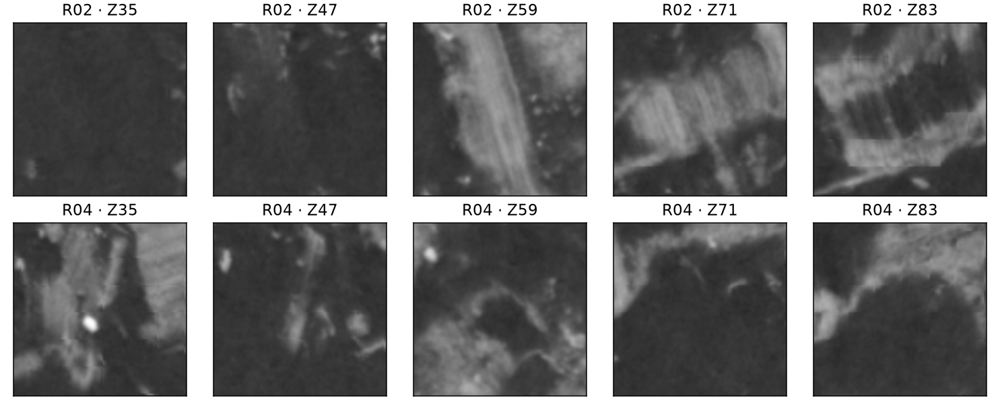

# Relecture CT indépendante de R02 et R04

Le [dossier CT neutre](../data/phase9/relecture-neutre-R02-R04-phase9.zip) s’utilise avec un lecteur TIFF. Il contient les intensités originales du rendu pour 62 coupes `[28,90)`, le CT59 et un masque par région. Chaque fichier CT est identique à la source de phase 8 et a une empreinte vérifiée. L’index donne les coordonnées globales V,U, le pas de 2,215 µm, l’acquisition `20250526151718`, la surface `20250919184428-0500P2-wrap01_0919` et les diagnostics de géométrie. Les deux fenêtres ont un support CT intégral. La face locale et l’existence d’une référence optique commune restent indéterminées.

| Région | Rectangle V,U à base zéro, fin exclue | Points à examiner |
| --- | --- | --- |
| R02 | V[644,772) U[636,764) | La coupe 59 montre une bande claire inclinée. Aux coupes 71 et 83, les faisceaux clairs occupent davantage le travers de la fenêtre. Vérifier sur les coupes intermédiaires si ces formes se prolongent dans une seule lamelle ou croisent une autre couche. |
| R04 | V[644,772) U[764,892) | La coupe 59 montre des contours courbes autour de zones sombres et un point lumineux vers le haut gauche. Aux coupes 71 et 83, une bordure claire occupe surtout le haut et la gauche. Suivre ces contours pour distinguer une fente, une limite de lamelle et une structure matérielle continue. |

Le fichier `LIRE.md` du ZIP invite le lecteur à relever la position, les coupes où la structure est visible, son interprétation physique et le degré d’incertitude. Examiner les volumes avant de consulter les cartes ou conclusions de modèle. Le dossier ne demande aucune attribution de caractère grec. Pour une expertise de l’encre, la référence à obtenir est une photo de situation avec emplacement et face sur le fragment. La séparation mesurée avec le maillage frontal est de l’ordre de 4,6 mm autour des deux régions et empêche leur assimilation directe au frontal publié. [Géométrie et limites](PHASE9_CT_OPTICAL_REGISTRATION.md)

[Empreintes des exports](validation/phase9-exports.json) · [Conditions et attribution Vesuvius Challenge Open Data](https://github.com/ScrollPrize/open-data#support-and-citation)
