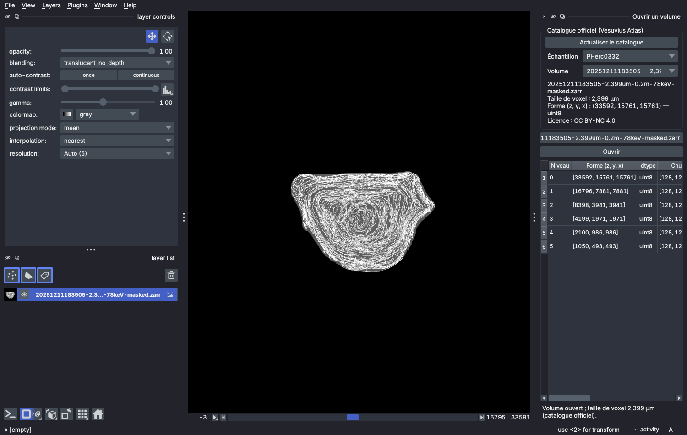
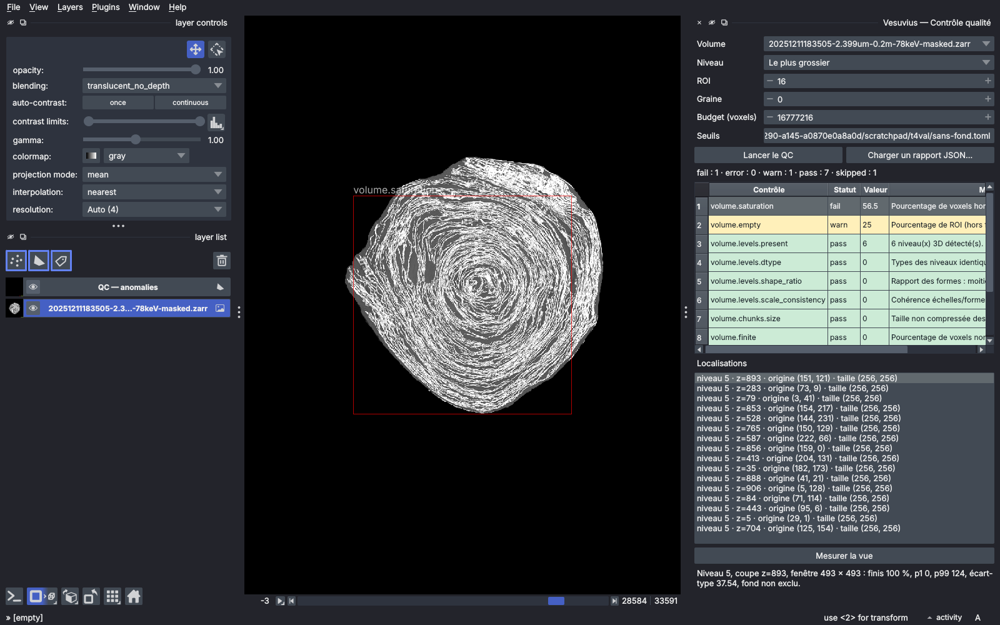
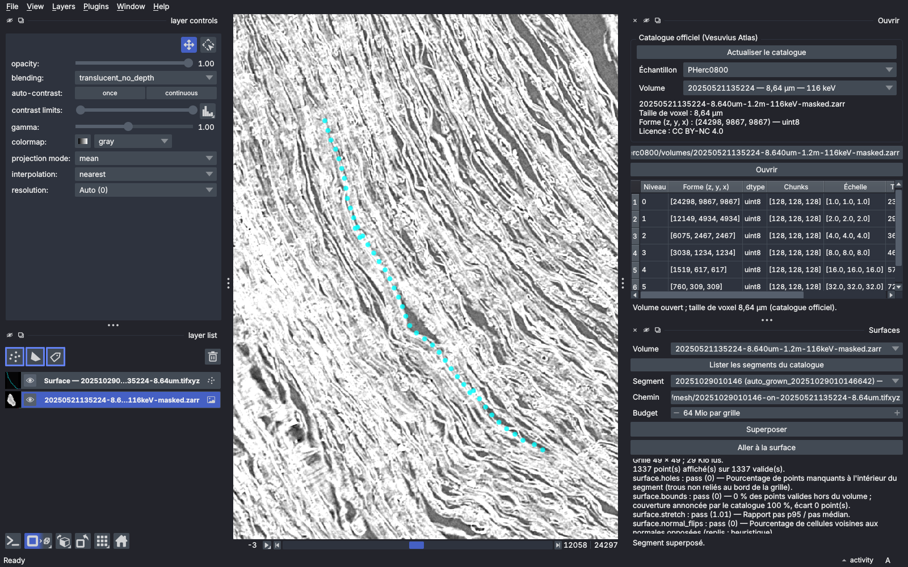
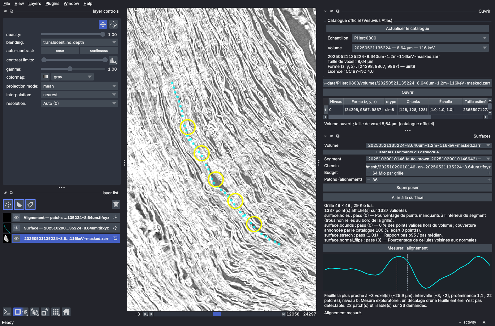
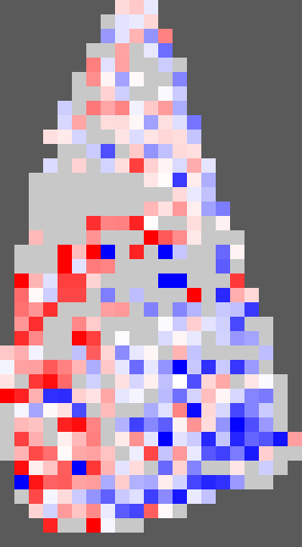

# Guide d'utilisation

Ce guide suit un parcours complet : installer l'outil, ouvrir un scan, le contrôler, vérifier une
surface VC3D, puis contrôler tous les segments d'un volume. Les captures viennent des validations
sur données réelles (extraits des scans du Vesuvius Challenge, CC BY-NC 4.0).

- [1. Installer](#1-installer)
- [2. Ouvrir un scan depuis le catalogue](#2-ouvrir-un-scan-depuis-le-catalogue)
- [3. Naviguer](#3-naviguer)
- [4. Contrôler la qualité d'un volume](#4-contrôler-la-qualité-dun-volume)
- [5. Vérifier une surface VC3D](#5-vérifier-une-surface-vc3d)
- [6. Mesurer l'alignement d'une surface](#6-mesurer-lalignement-dune-surface)
- [7. Contrôler tous les segments d'un volume](#7-contrôler-tous-les-segments-dun-volume)
- [8. Carte d'alignement et recalage d'un segment](#8-carte-dalignement-et-recalage-dun-segment)
- [9. En ligne de commande](#9-en-ligne-de-commande)
- [10. Dépannage](#10-dépannage)

## 1. Installer

Il faut Python 3.11 ou plus, et une connexion internet pour les données publiques.

```bash
python -m venv .venv
source .venv/bin/activate          # Windows : .venv\Scripts\activate
pip install "vesuvius-data-explorer[napari] @ git+https://github.com/AtomCrtr/vesuvius-data-explorer-atom.git"
```

Vérifier l'installation :

```bash
vesuvius-qc --help
napari -w vesuvius-data-explorer
```

La seconde commande ouvre napari avec le widget **Vesuvius — Ouvrir un volume** à droite. Les deux
autres widgets se trouvent dans le menu **Plugins**.

**Chargement asynchrone.** À la première ouverture, le widget peut proposer **Activer le chargement
asynchrone (préférence napari)**. Accepter : sans ce réglage, napari lit les données sur son fil
principal et l'interface se fige pendant la navigation. Le plugin ne change jamais ce réglage sans
votre clic.

## 2. Ouvrir un scan depuis le catalogue

1. Cliquer sur **Charger le catalogue officiel**. Le fichier (9 Mo) est téléchargé une fois, puis
   gardé 24 h.
2. Choisir l'**échantillon** (par exemple PHerc0332), puis le **volume**. La fiche affiche la taille
   de voxel, la forme, la licence, et signale les copies au format `vc-delta3d` ou remplacées.
3. Cliquer sur **Ouvrir**. Le tableau liste les niveaux de résolution ; le message rappelle la taille
   de voxel.



On peut aussi saisir un chemin à la main : dossier `.zarr` local, URI `s3://` publique ou URL
`https://data.aws.ash2txt.org/…`.

**Avertissement de forme.** Si la forme réelle du volume diffère de celle annoncée par le catalogue,
le widget le signale. C'est le cas de Scroll 1 : la fiche annonce 14 369 coupes, le volume publié
en a 14 258, ce qui correspond au recadrage décrit dans la même fiche. Les métadonnées Zarr font
foi.

## 3. Naviguer

- Le curseur sous l'image change de coupe ; la molette zoome. napari choisit seul le niveau de
  résolution adapté au zoom.
- La **première vue** d'une région prend environ 3 s : il faut télécharger les blocs de données. Les
  coupes suivantes s'affichent en 0,2 à 0,5 s grâce au **cache local**.
- Le bouton **Vider le cache local**, en bas du widget d'ouverture, affiche la taille du cache et le
  vide. Limite : 10 Gio.
- Le contraste initial ignore le fond noir des volumes masqués ; il reste réglable dans le panneau
  de gauche de napari.

## 4. Contrôler la qualité d'un volume

Menu **Plugins → Vesuvius — Contrôle qualité**.

1. Choisir le **niveau** (« Le plus grossier » par défaut, rapide), le nombre de **ROI** (fenêtres
   tirées au hasard) et éventuellement un fichier de seuils.
2. Cliquer sur **Lancer le QC**. Le tableau montre chaque contrôle, les échecs en premier.
3. Cliquer sur un contrôle, puis sur une localisation : la vue va sur la coupe concernée, et un
   rectangle rouge (échec) ou orange (alerte) entoure la zone.
4. **Mesurer la vue** donne les statistiques de la zone affichée.



Pour localiser finement une anomalie, relancer le QC sur un niveau plus fin : au niveau le plus
grossier, une fenêtre couvre une grande partie de la coupe.

## 5. Vérifier une surface VC3D

Menu **Plugins → Vesuvius — Surfaces**, après avoir ouvert un volume **depuis le catalogue**.

1. **Lister les segments du catalogue** : seuls les segments déjà convertis dans le repère de ce volume
   sont proposés, avec leur couverture.
2. Choisir un segment, puis **Superposer**. La **trace** du segment apparaît en cyan sur la coupe
   affichée et suit la coupe quand on la change. Les centres des trous intérieurs sont en rouge.
3. **Aller à la surface** amène la vue sur le segment.



La fiche donne les indicateurs :

| Indicateur | Ce qu'il dit |
|---|---|
| `surface.holes` | points manquants à l'intérieur du segment (le bord irrégulier ne compte pas) |
| `surface.bounds` | points hors du volume, comparés à la couverture annoncée par le catalogue |
| `surface.stretch` | régularité du maillage |
| `surface.normal_flips` | replis : cellules voisines orientées en sens opposé |
| `surface.valid` | part de points valides (informatif) |

## 6. Mesurer l'alignement d'une surface

Après **Superposer**, cliquer sur **Mesurer l'alignement**. L'outil lit l'intensité du volume de part
et d'autre de la surface, sur 36 petites zones, et cherche la feuille de papyrus (plus claire) la plus
proche.



- Le **graphique** montre l'intensité moyenne en fonction de la distance à la surface ; la ligne
  rouge marque la feuille trouvée.
- Le résultat indique la distance en voxels et en µm, et commence par **« Alerte — »** si la surface
  est à plus de **30 µm** de sa feuille **et** que la mesure est fiable.
- « Mesure peu fiable, non notée » : le pic de la feuille n'est pas net (environ deux segments sur
  trois). « Alignement indéterminé » : aucune feuille n'est identifiable.
- Limite : un segment décalé d'**une feuille entière** paraît aligné ; cette mesure ne peut pas le
  détecter.

## 7. Contrôler tous les segments d'un volume

En ligne de commande, avec l'identifiant du volume (visible dans le sélecteur de catalogue) :

```bash
vesuvius-qc lot 20250804134230 -o PHerc0814/
```

- Les segments sont traités en parallèle ; la progression s'affiche ligne par ligne.
- Le dossier contient `synthese.html` (tableau coloré, détails au survol), `synthese.csv`,
  `synthese.json` et un rapport complet par segment dans `rapports/`.
- Exemple réel : les 19 segments de PHerc0814 en 106 s, dont 12 signalés pour des trous intérieurs
  ([validation](validation/T7-qc-en-lot.md)).
- `--max-segments 5` pour un essai rapide, `--sans-alignement` pour aller plus vite.

## 8. Carte d'alignement et recalage d'un segment

Pour savoir **où** une surface s'écarte de sa feuille, et non plus seulement si elle s'en écarte en
moyenne :

```bash
vesuvius-qc carte 20250825181928 --catalogue -o carte/
```

- Le segment est découpé en **tuiles** de 8 × 8 points (environ 160 voxels de côté). Pour chacune,
  l'outil mesure la distance à la feuille la plus proche, sa fiabilité et son incertitude.
- La **dérive** est mesurée par rapport à la position habituelle du segment : les segments publiés
  suivent une face de la feuille, environ 10 µm à côté de son centre clair.
- Le dossier contient `rapport.html` (carte colorée, rendu aplati, zones à revoir),
  `decalage.tif`, `fiabilite.tif`, `incertitude.tif` (une valeur par tuile), `zones.json` (régions à
  revoir, de la plus grave à la moins grave, avec leurs lignes, colonnes et centre 3D) et
  `carte.json` (chiffres clés).



**Recalage.** `--recaler` écrit une copie corrigée dans `carte/recale/` ; l'original n'est jamais
modifié.

- Seules les tuiles fiables bougent, de 50 µm au plus (`--deplacement-max`).
- Tous les points des zones exclues restent fixes. Le déplacement s'atténue sur le bord
  des tuiles recalées.
- `--cible -10` vise un décalage précis (en µm) au lieu de la position habituelle du segment, pour
  corriger aussi un décalage d'ensemble.

Dans **Vesuvius — Surfaces**, superposez le segment à son volume puis cliquez sur
**Cartographier la dérive**. Le calque coloré suit les coupes et reste visible en 3D.
Les tuiles grises signalent un signal peu fiable ou une mesure indisponible. Choisissez une
zone dans la liste pour centrer la coupe sur ses coordonnées 3D.

Limites : environ une tuile sur trois seulement est fiable ; un saut de feuille n'est pas
détecté comme tel sur les vraies données, il apparaît comme une zone peu fiable ou une forte dérive
([validation](validation/T10-carte-alignement.md)). Pour un grand segment, la première carte
télécharge tous les blocs que la surface traverse (jusqu'à plusieurs gigaoctets).

## 9. En ligne de commande

```bash
# Volume : fenêtres tirées au hasard, rapport JSON et HTML
vesuvius-qc volume <URI du volume> --samples 16 -o rapport.json --html rapport.html

# Surface : indicateurs, et alignement si le volume est fourni
vesuvius-qc surface <URI du segment> --volume <URI du volume> --pixel-size-um 8.64 -o surface.json

# Lot : tous les segments d'un volume du catalogue
vesuvius-qc lot <identifiant du volume> -o dossier/

# Carte d'alignement d'un segment, avec copie recalée
vesuvius-qc carte <URI du segment> --volume <URI du volume> --pixel-size-um 2.4 --recaler -o carte/
```

Les seuils se changent dans un fichier TOML passé par `--config`, par exemple :

```toml
["surface.holes"]
warn = 2.0
fail = 10.0

["surface.alignment"]
max_offset_um = 40
```

Codes de sortie : 0 tout passe, 1 au moins un échec, 2 entrée invalide.

## 10. Dépannage

| Symptôme | Solution |
|---|---|
| L'interface se fige en naviguant | Activer le chargement asynchrone (bouton du widget, ou Préférences de napari). |
| « Catalogue officiel inaccessible » | Vérifier la connexion ; sinon saisir le chemin du volume à la main. |
| « Codec de compression « vc-delta3d » non pris en charge » | Installer l'option : `pip install "vesuvius-data-explorer[vcdelta3d]"` (Python 3.12 ou plus), ou choisir la copie standard du volume. |
| « fichier compressé … au-delà du budget » (surface) | Augmenter le budget de lecture des surfaces (widget, ou `--max-bytes`). |
| Le cache prend trop de place | **Vider le cache local**, ou limiter avec `VESUVIUS_CACHE_MAX_GB=2`. |
| Lecture lente au tout premier affichage | Normal : les blocs sont téléchargés une fois, puis servis par le cache. |

Pour le détail de chaque comportement, voir la [référence technique](reference.md).
