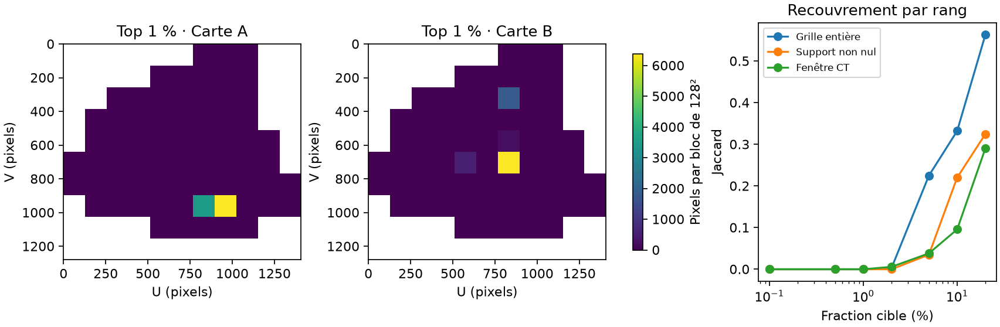

# PHerc0500P2 · Causes du désaccord

Sur le support non nul commun, les 9 865 pixels du top 1 % de A
se concentrent dans deux blocs de 128 × 128. Aucun top de B n’est
à moins de 208 pixels de ces pixels selon la distance de Chebyshev.
Les 14 641 translations entières de ±60 pixels par axe donnent
toutes un recouvrement nul. L’inversion des coupes modifie la
réponse du checkpoint canonique sur une tuile où l’on peut contrôler
cette seule variable. Les données disponibles ne permettent pas
d’isoler sa contribution au désaccord des deux cartes publiées.
[Mesures](../../validation/phase6-disagreement-windows.json) · [Essai en profondeur](../encre/CUDA_INFERENCE_VALIDATION.md)

## Grille, repères et prétraitement

| Élément | Résultat de l’audit |
|---|---|
| A | Atlas `20260417190342-new_canon_autoresearch_recipe`, ResNet3D-152 avec décodeur 3D et normalisation apprise dans le checkpoint public. |
| B | Atlas `20260709123958-mrg20736-1um-s1z2`, ResNet3D-152. Le chargeur public de cette architecture réduit la profondeur par maximum pour chaque carte de caractéristiques et utilise un décodeur 2D. La normalisation apprise dépend des clés présentes dans le checkpoint. |
| Rendu | TIFXYZ historique `20250919184428-on-20250526151718-2.215um.tifxyz`. Le stack `[Z,V,U]` mesure 118 × 1 160 × 1 400 au niveau 0. Le repère UV de sortie conserve lignes et colonnes du rendu, sans réflexion ni rotation déclarées. |
| Ordre Z | Atlas passe `[28,90[` à chaque modèle sur le même stack. Dans le code public, A reçoit les indices 28 à 89, B 89 à 28. L’inversion s’applique au dernier axe du bloc VUZ juste avant sa conversion en tenseur ZVU. Elle ne change ni les positions UV ni l’ensemble des coupes. |
| Orientation physique | `flip-normals=true` appartient au rendu commun. Il décrit le sens d’échantillonnage le long des normales du maillage. L’identité recto/verso de la couche et l’origine physique du signal vu par chacun des réseaux restent inconnues. |
| Résolution | 2,215 µm au L0 du rendu et sur la grille publiée. Le domaine annoncé de B est 1–1,5 µm. Le catalogue indique une exigence de niveau de rendu sans attester une conversion interne lors de l’exécution. |
| Prétraitement public | Le code exclut les pixels dont toutes les coupes sont à zéro, écrête les intensités à 200, divise par 200 et les transmet sous forme de tenseur flottant. Avec une tuile et une taille modèle de 256², le passage ne redimensionne pas le CT. |
| Post-traitement public | Sigmoïde, interpolation bilinéaire vers la tuile, accumulation pondérée sur les zones valides, réduction des partitions et conversion `uint8` de `255 × score`. Hann est la valeur par défaut de la version publique lue. La configuration exacte et le digest de production `v43` restent à établir. |
| Domaine et checkpoints | TIFF d’intensités quantifiées, sans calibration attestée. Le checkpoint A public est exécutable et vérifié par SHA-256. Aucun hash ne relie formellement cette publication au fichier chargé par le job de juillet. Le checkpoint B exact n’a pas été trouvé dans les dépôts publics examinés. |

La chaîne Atlas rattache les deux exécutions au même rendu. Les
empreintes des TIFF sont vérifiées à la lecture. Les résultats CT de
la phase 4 corroborent la correspondance des pixels avec le maillage
historique et défavorisent la révision TIFXYZ `-t2`. La résolution,
l’orientation physique et la face d’un signal en profondeur ne se
déduisent pas de la forme des scores.
[Chaîne Atlas](../encre/INK_PROVENANCE_AUDIT.md) · [Code public du prétraitement](https://github.com/ScrollPrize/villa/blob/baf5e605bb42a3d55a62b7c5c728e0908137225c/ink-detection/optimized_inference/inference.py#L273) · [Décodeur de B](https://github.com/ScrollPrize/villa/blob/baf5e605bb42a3d55a62b7c5c728e0908137225c/ink-detection/optimized_inference/model_resnet3d.py#L100)

## Effets du fond et de la fenêtre

| Domaine | Pixels appariés | Pearson | Spearman | Jaccard à 50 % | Dice à 50 % | Désaccord à 50 % |
|---|---:|---:|---:|---:|---:|---:|
| Grille entière | 1 624 000 | 0,790 | 0,952 | 0,397 | 0,568 | 10,6 % |
| Support non nul commun | 790 200 | 0,580 | 0,636 | 0,397 | 0,568 | 21,8 % |
| Masque du maillage historique | 872 400 | 0,645 | 0,729 | 0,397 | 0,568 | 19,8 % |
| Fenêtre CT [388,772[ × [508,892[ | 147 456 | 0,466 | 0,502 | 0,477 | 0,646 | 33,5 % |

Aucun TIFF ne contient de valeur non finie. Les 833 800 codes zéro
communs gonflent les corrélations de la grille entière. Le masque
historique contient tout le support positif, plus 82 200 pixels
de code zéro. La fenêtre CT contient exclusivement des codes non
nuls. Le calcul utilise des rangs moyens pour Spearman et dénombre
les pixels exclus. Un seuil conserve l’égalité sur l’échelle 0–255.
Une valeur 0 dans un TIFF est un code, sans conclusion sur l’encre
ou la disponibilité physique en l’absence d’un masque d’acquisition.

| Seuil sur 255 | Jaccard sur support non nul | Dice |
|---:|---:|---:|
| 20 % | 0,578 | 0,733 |
| 35 % | 0,496 | 0,664 |
| 50 % | 0,397 | 0,568 |
| 65 % | 0,267 | 0,421 |
| 80 % | 0,065 | 0,123 |
| 90 % | 0,000 | 0,000 |

## Concentration et transformations témoins

| Top cible | k demandé | Pixels communs, support entier non nul | Jaccard |
|---:|---:|---:|---:|
| 0,1 % | 791 | 0 | 0 |
| 0,5 % | 3 951 | 0 | 0 |
| 1 % | 7 902 | 0 | 0 |
| 2 % | 15 804 | 0 | 0 |
| 5 % | 39 510 | 2 860 | 0,035 |
| 10 % | 79 020 | 29 072 | 0,220 |
| 20 % | 158 040 | 78 000 | 0,325 |

Tous les ex æquo sont retenus. Les seuils top 1 % valent 236 pour A
et 214 pour B. Le bloc [896,896] contient 6 381 des 9 865 pixels de
A, le bloc [896,768] les 3 484 restants. Le plus grand bloc de B,
[640,768], en contient 6 375 sur 9 089. Le top 1 % local est
également disjoint, avec une autre population et d’autres coupures.
Le top 1 % de la grille entière reste disjoint malgré le k plus élevé.



Les décalages sans repli de bord comparent les masques de rang
figés avant la translation. À 16 pixels de décalage, l’autocorrélation
de chaque carte reste comprise entre 0,967 et 0,990 sur les axes
testés. Ce lissage rend les corrélations de scores voisines sur
plusieurs décalages et peu discriminantes pour le recalage. Les
réflexions V/U et la rotation 180° ont toutes un IoU de support
inférieur à 0,700, et aucun pixel top 1 % en commun. Les contrôles
asymétriques synthétiques retrouvent une translation connue et
rejettent une réflexion. Les hypothèses testées restent des
diagnostics et la grille adoptée reste celle des sources.
[Résultats, distributions et décalages axiaux](../../validation/phase6-disagreement-windows.json) · [Constat indépendant sur les TIFF](https://github.com/ScrollPrize/villa/issues/1377)

Le contraste de résolution, le décodeur, l’entraînement différent,
les réglages de production et le sens de profondeur restent des
explications plausibles. Une calibration strictement monotone
et un décalage UV de la plage testée ne peuvent expliquer
la séparation des extrêmes à eux seuls. La prochaine comparaison
causale devra croiser deux checkpoints attestés et deux ordres Z,
à résolution, grille, témoins et assemblage de tuiles fixes.

```powershell
.venv/Scripts/python.exe docs/validation/phase6_disagreement.py docs/validation/phase5-provenance-windows.json data/phase6 docs/validation/phase6-disagreement-windows.json --plot docs/validation/phase6-disagreement.png
```
