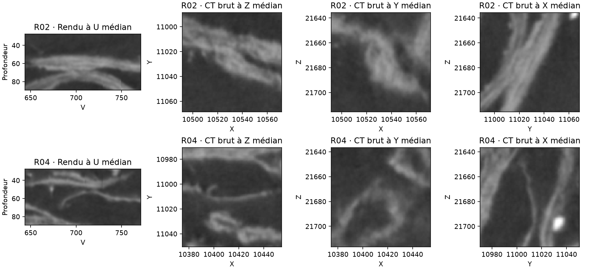

# Vesuvius Explorer · Phase 10

La recherche a retrouvé le **JPEG de prise de vue IR Naples M1050 n° 017**, ainsi que la pile CT, l’IR aligné et les masques du frontal historique de PHerc0500P2. Le champ optique ν2 reste sans localisation démontrée. La priorité est désormais de récupérer les emprises et les coordonnées qui relient cette acquisition optique aux références retrouvées. [Audit des sources](PHASE10_SOURCE_INVESTIGATION.md)

## Conclusions

| Question | Résultat |
| --- | --- |
| Quelle preuve manque pour ν2 ? | L’emprise et l’orientation de `500P2_230925_N2` sur une photo de situation ou un relevé de platine, et un lien géométrique traçable de cette référence à la grille CT choisie. La grille frontale historique et la grille Atlas ont des dimensions différentes. [Chaîne de coordonnées](PHASE10_REGISTRATION_EVIDENCE.md) |
| Qui peut la fournir ? | Giorgio Angelotti a collecté les données optiques. Federica Nicolardi peut aider à identifier la pièce et la face. L’équipe qui a préparé le frontal IR et le composite CT peut retrouver le recalage. L’Officina de Naples ou EduceLab peut confirmer la cote et les conditions d’accès. [Brouillons Discord et email](PHASE10_AUTHOR_CONTACT.md) |
| Peut-on résoudre la calibration ? | L’export confirme 0,68793625 µm/pixel et l’article cite 0,34. Le fabricant documente des configurations proches de 0,69 µm. Le journal d’étalonnage ou une distance indépendante mesurée sur la même grille est nécessaire pour trancher. [Calibrations possibles](PHASE10_SOURCE_INVESTIGATION.md#calibration) |
| Quel jeu alternatif ? | **EduceLab Frag4**, PHercParis1Fr39. Les index, rasters et artefacts d’alignement sont accessibles. La réserve historique de Kaggle ne renseigne pas l’exclusion pour A. Les huit fenêtres Frag1 et Frag3 déjà locales ont passé un nouveau contrôle d’empreintes et de masques. Aucun jeu n’est encore admis pour une mesure indépendante d’A. [Classement et pilote](PHASE10_ALTERNATIVE_DATASETS.md) |
| L’ordre Z mérite-t-il un partage ? | Oui, sous forme de note de méthode en complément de Villa #1377. L’essai à poids A, entrées et assemblage constants mesure un effet détaillé sur tout un rendu, répété sur CUDA et contrôlé par le CT brut. L’encre, la face et la contribution de l’ordre à l’écart des deux modèles de production restent ouvertes. [Brouillon technique](PHASE10_COMMUNITY_REPORT.md) |
| Quelle expérience ensuite ? | Obtenir l’emprise ν2, les points IR→CT et la calibration pour un seul champ. En parallèle, préparer un contrôle local CT/IR sur Frag4 sans prédictions. Une évaluation d’A attend la géométrie contrôlée et la preuve d’exclusion du manuscrit parent pour le SHA-256 d’A. |

Les brouillons restent locaux. Aucun envoi ni publication n’a été effectué.

## Relecture neutre R02 et R04

Le nouveau ZIP reprend les huit membres du dossier de phase 9 à l’octet près, avec deux cubes ZYX natifs de 80³ voxels, leurs empreintes et une fiche de relevé. Les centres sont tirés du maillage historique, près de V700 U700 pour R02 et V700 U820 pour R04. La relecture peut vérifier en R02 les bandes claires séparées sur les coupes adjacentes, et en R04 les contours du matériau autour de zones peu intenses. Les trois plans L0 montrent des structures sur le CT natif au voisinage de ces témoins. Le suivi en 3D et la distinction entre lamelles, fissures et fibres restent à interpréter. Les coupes centrales couvrent une zone plus petite que la fenêtre entière. [Fiche et observations à consigner](PHASE10_R02_R04_REVIEW.md) · Dossier CT (`data/phase10/relecture-CT-R02-R04-phase10.zip`) · [Positions et SHA-256](../../validation/phase10-review.json)



Pour reproduire l’extraction depuis la racine du projet sous Windows, avec la pile S3/Dask et le TIFXYZ de phase 8

```powershell
& .venv/Scripts/python.exe docs/validation/phase10_review.py data/phase10 docs/recherche/phase-10/PHASE10_R02_R04_REVIEW.md docs/validation/phase10-review.json docs/validation/phase10-review-depth.png
```

## Préservation et vérification

`feat/vesuvius-phase10` reprend l’arbre de travail de la phase 9 au commit de base `eba4082134df544dc56b5f9d6622d9fd0161f36c`. L’archive de restauration contient 185 fichiers et un manifeste qui épingle les quatre fichiers optiques conservés à leur emplacement d’origine. Les restitutions des données, les empreintes et les CRC ont été vérifiés. Les sources réseau sont consignées avec statut et SHA-256 des réponses. Le rendu, les artefacts négatifs de ν2 et le poids A de référence restent disponibles.

Le seul nouveau script assemble le dossier neutre à partir du CT publié. L’application conserve Python par défaut, Rust facultatif, S3/Dask, le cache, napari, CUDA et les conventions existantes. Sur Windows, **355 tests natifs** et **80 tests ciblés avec Rust** ont réussi. La suite native a ignoré un test qui exige `vc_delta3d` dans un autre environnement. Journaux Windows (`data/phase10/windows-tests.log`) · Journal Rust (`data/phase10/windows-rust-tests.log`) · [Journal de provenance](../../validation/phase10-sources.json)

Archive de restauration (`data/phase10/phase9-before-phase10.zip`) · SHA-256 (`data/phase10/phase9-before-phase10.sha256`)
