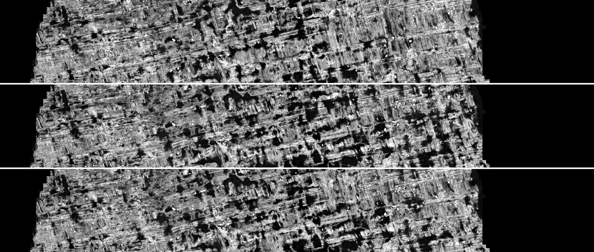
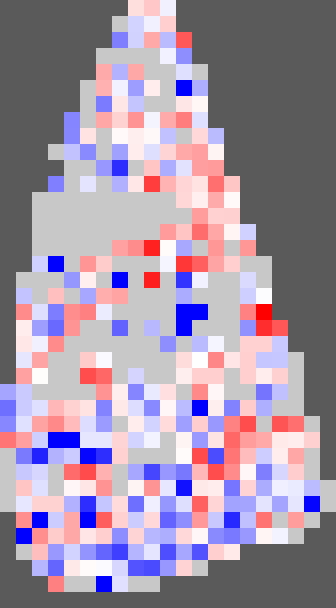
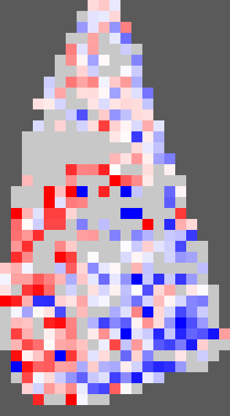
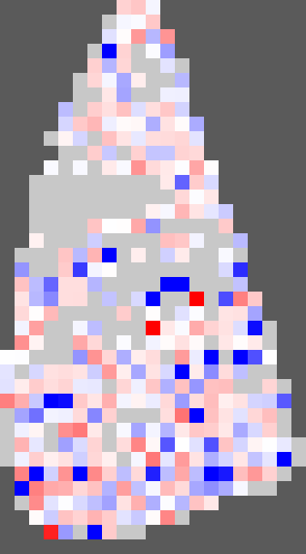
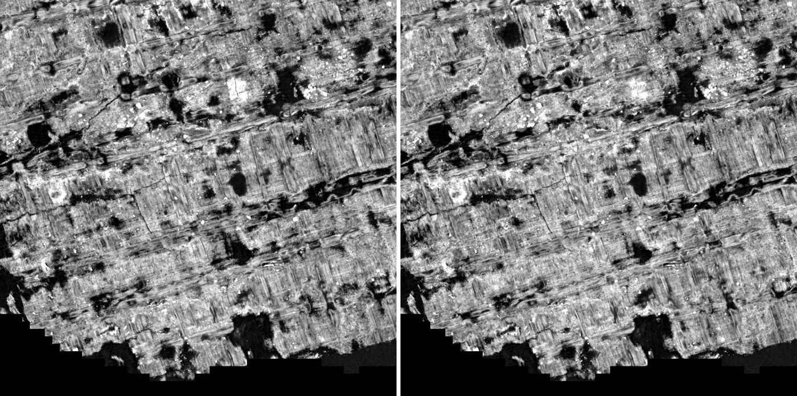

# T10 — Carte d'alignement et recalage : validation sur données réelles

Validation du 18 novembre 2026 selon le protocole de la
[spécification](../tasks/T10-carte-alignement.md).

- Script : [`T10_validation.py`](T10_validation.py), graine 7.
- Données brutes : [`t10-validation.json`](t10-validation.json).

## Conclusion

| Critère de la spécification | Seuil | Résultat |
|---|---|---|
| 1a. Dérive lente imposée (rampe de 0 à 40 µm) retrouvée à 2 pas près, tuiles fiables | ≥ 80 % | **96 %** (1 588 / 1 649 tuiles), de 88 % à 100 % selon le segment |
| 1b. Sauts de feuille artificiels localisés | ≥ 80 % | **Non validable sur données réelles** (section 4) |
| 2a. Après recalage d'une dérive imposée, dérive médiane | < 1 pas (≈ 9 µm) | **3,5 à 5,8 µm** sur les 7 segments mesurables |
| 2b. Recalage d'un segment publié : la fiabilité ne baisse pas | jamais | **tenu** : fiabilité médiane égale ou en hausse sur 8 / 8 |
| 3. Fibres visibles, rendus avant / après | 5 segments, 3 résolutions | **8 segments, 3 résolutions** ; fibres visibles ; gain quantitatif faible (section 3) |
| 4. Coût | documenté | 10 à 80 s par carte, 1 à 7 Gi-voxels décodés (section 5) |
| 5. Comparaison avec les outils voisins | documentée | **à faire** |

La carte mesure correctement la dérive et le recalage la retire. En revanche, la détection des sauts
de feuille par la phase, prévue par la spécification, ne fonctionne pas sur les données réelles :
c'est un écart à décider par le PO.

## 1. Échantillon et conditions

- **8 segments** `tifxyz-transformed` actuels, sur des volumes du bucket S3, un segment par volume,
  `x.tif` de 40 à 400 Kio, tirés avec la graine 7 :
  - 3 à environ 8 µm (9,362 et 8,64 µm), lus au niveau 0 ;
  - 3 à environ 2,4 µm (2,215 à 2,403 µm), niveau 2 ;
  - 2 à 1,129 µm (seuls 2 segments de cette classe remplissaient les conditions), niveau 3.
- Tuiles de 8 × 8 points (environ 160 voxels du niveau 0 de côté), portée ±200 µm, voxel de
  lecture ≤ 10 µm. Une tuile est **fiable** si sa fiabilité (hauteur du pic divisée par l'erreur
  type du profil moyen) est d'au moins 3.
- Recalage : plafond de 50 µm, lissage λ = 0,5.

## 2. Résultats par segment

| Classe | Segment | Voxel (µm) | Tuiles mesurées / fiables | Décalage habituel (µm) | Carte | Gi-voxels | 1a. Rampe retrouvée | 2a. Dérive (µm) avant → après | Pas (µm) | 2b. Fiabilité médiane | Intensité moyenne du rendu | Contraste des fibres (%) |
|---|---|---|---|---|---|---|---|---|---|---|---|---|
| ~8 µm | `20260226110425` | 9,362 | 214 / 108 | −10,5 | 10 s | 1,2 | 100 % (97) | 12,5 → **5,8** | 9,4 | 3,03 → 3,06 | 109,3 → 111,0 | 21,0 → 20,5 |
| ~8 µm | `20250919125754` | 8,64 | 1 401 / 403 | −14,4 | 41 s | 7,2 | 98 % (348) | 10,4 → **4,0** | 8,6 | 2,18 → 2,18 | 99,4 → 101,1 | 12,4 → 12,2 |
| ~8 µm | `20250502184658` | 8,64 | 252 / **0** | 3,2 | 12 s | 1,4 | — | — | 8,6 | 0,61 → 0,61 | 110,8 → 110,8 | 12,5 → 12,5 |
| ~2,4 µm | `20260220214732` | 2,403 | 582 / 131 | −7,8 | 67 s | 2,8 | 88 % (104) | 15,9 → **5,6** | 9,6 | 1,77 → 1,80 | 82,5 → 83,8 | 17,4 → 17,2 |
| ~2,4 µm | `20260226123353` | 2,399 | 224 / 58 | −11,7 | 28 s | 1,1 | 93 % (43) | 13,5 → **3,8** | 9,6 | 1,91 → 1,91 | 98,3 → 99,0 | 18,7 → 18,7 |
| ~2,4 µm | `20250825181928` | 2,215 | 509 / 356 | −5,2 | 53 s | 2,5 | 97 % (330) | 8,9 → **4,6** | 8,9 | 4,27 → 4,36 | 98,8 → 100,3 | 9,2 → 9,0 |
| ~1,1 µm | `20260226113324` | 1,129 | 683 / 284 | −6,4 | 31 s | 1,0 | 92 % (247) | 17,7 → **5,2** | 9,0 | 2,88 → 2,92 | 41,1 → 42,5 | 33,4 → 31,7 |
| ~1,1 µm | `20260316000000` | 1,129 | 615 / 489 | −8,5 | 80 s | 3,5 | 98 % (480) | 11,8 → **3,5** | 9,0 | 6,52 → 6,55 | 129,2 → 131,4 | 9,6 → 9,3 |

- **Décalage habituel** : médiane de −5 à −15 µm, comme dans l'audit d'I2 (environ −10 µm).
- **Un segment sans aucune tuile fiable** (`20250502184658`) : la carte le signale entièrement en
  zones « sans feuille » et le recalage ne le déplace pas. C'est le comportement voulu.
- **Part des tuiles fiables** : de 0 à 80 % selon le segment, médiane 36 %. La carte ne dit rien des
  autres tuiles, sinon qu'elles sont à revoir.
- **Cohérence spatiale**, mesurée à part sur 4 autres segments : la dérive d'une tuile fiable
  ressemble à celle de ses voisines (corrélation de 0,25 à 0,86 selon le segment pour
  une fiabilité ≥ 6). La carte mesure donc un signal, pas seulement du bruit, surtout sur les volumes à
  2,4 µm.

## 3. Recalage et fibres

**Segment décalé puis recalé.** Segment `20250825181928` de PHerc0500P2 (2,215 µm). En haut, le
segment publié ; au milieu, le même segment décalé le long de ses normales de 0 µm (à gauche) à
40 µm (à droite) ; en bas, après recalage vers le décalage habituel du segment publié
(option `--cible`) :

- Au milieu, la partie droite s'assombrit et les fibres s'y brouillent : la surface quitte la
  feuille.
- En bas, elle redevient semblable au segment publié. Intensité moyenne : 92,8 (publié), 89,7
  (décalé), 92,0 (recalé).
- Décalage mesuré par groupe de colonnes, de gauche à droite : publié −18, −4, −10, −2, −6 µm ;
  décalé −18, −10, −22, −27, −35 µm ; recalé −9, −3, −7, −5, −11 µm.

Cartes de dérive correspondantes (blanc : décalage habituel ; bleu ou rouge : dérive ; gris :
peu fiable) :

| Publié | Décalé | Recalé |
|---|---|---|
|  |  |  |

**Cible du recalage.** Par défaut, le recalage ramène chaque tuile au décalage habituel **du
segment lui-même** : une dérive locale disparaît, mais un décalage d'ensemble reste. Sur le segment
décalé ci-dessus, le recalage par défaut laisse ainsi tout le segment à environ −24 µm, la moyenne
de la rampe. L'option `--cible` donne le décalage à viser : celui d'un état de confiance du segment,
ou l'habitude des segments publiés (environ −10 µm).

**Segments publiés recalés.** Ils sont déjà bien placés : le déplacement médian va de 0 à 3,4 µm, au
plus 50 µm (plafond). Les rendus avant / après se ressemblent beaucoup ; quelques zones sombres
s'éclaircissent :

**Mesure des fibres.** L'intensité moyenne du rendu augmente de 0,7 à 3,4 % sur les 7 segments
recalés : la surface se rapproche de la feuille. La mesure de contraste des fibres (énergie
passe-bande divisée par l'intensité moyenne) baisse de 0 à 5 %, en partie parce que son dénominateur
augmente. **Aucun gain de netteté des fibres n'est démontré** sur des segments publiés ; le gain est
net sur un segment dégradé volontairement.

Extraits des données PHerc0500P2 : Vesuvius Challenge, *CT Scans of Herculaneum Papyri*,
[citation](https://github.com/ScrollPrize/open-data#support-and-citation),
[CC BY-NC 4.0](https://creativecommons.org/licenses/by-nc/4.0/) ; la licence MIT du code ne
s'applique pas à ces images.

## 4. Écart : les sauts de feuille par la phase

La spécification prévoit de convertir la dérive en phase avec l'espacement des feuilles `Δ`, puis de
localiser les sauts de feuille par les résidus de phase (I2, section 3.3). Sur données
synthétiques, cela fonctionne : une dérive de plus d'une feuille est déroulée et la ligne de saut
est signalée (tests automatiques).

**Sur les vraies données, l'espacement des feuilles n'est pas mesurable.** Profil moyen et
autocorrélation des profils de tuiles, sur 4 segments de 3 résolutions, portée jusqu'à ±400 µm :

- le profil montre la feuille suivie (un pic) et l'espace sombre qui la borde, mais **pas de
  feuilles voisines régulièrement espacées** ;
- l'autocorrélation ne présente pas de second pic net (au plus 0,05 du pic central, sous le seuil
  de 0,2 retenu) ;
- sur les 8 segments de validation, l'espacement n'est trouvé pour **aucun** : l'analyse de phase
  ne s'active pas.

Les feuilles d'un rouleau carbonisé sont comprimées, décollées et d'épaisseur variable : à l'échelle
d'une tuile, elles ne forment pas un réseau périodique. Le critère 1b ne peut donc pas être validé.
La détection reste dans le code (elle s'active seule si l'espacement est mesurable) ; un saut de
feuille sur données réelles n'apparaît aujourd'hui que comme une zone peu fiable ou une forte
dérive.

## 5. Coût

- Temps de la carte : 10 à 80 s par segment (de 224 à 1 401 tuiles mesurées), téléchargement
  compris depuis S3, dans l'environnement de validation.
- La carte lit tous les blocs Zarr que la surface traverse : de 1 à 7 Gi-voxels décodés. Chaque bloc
  n'est lu et décompressé qu'une fois par carte (cache de blocs décodés, lecture en parallèle).
- Les volumes publiés en HTTPS non compressés (Scroll 1) coûtent beaucoup plus : 2 Mo par bloc, de
  l'ordre de 4 à 8 Go pour un grand segment, soit plusieurs dizaines de minutes au débit mesuré ici
  (2,6 Mo/s). Les exécutions suivantes viennent du cache local (10 Gio au plus).

## 6. Reste à faire

- Décision du PO sur l'écart de la section 4.
- Comparaison avec les outils voisins (ScrollFiesta, raffinement nnInteractive, patchs de
  W. Stevens).
- Intégration dans napari (calque de la carte, navigation dans les zones à revoir).
- Seuils provisoires à confirmer : fiabilité ≥ 3, lissage 0,5, plafond de 50 µm.
