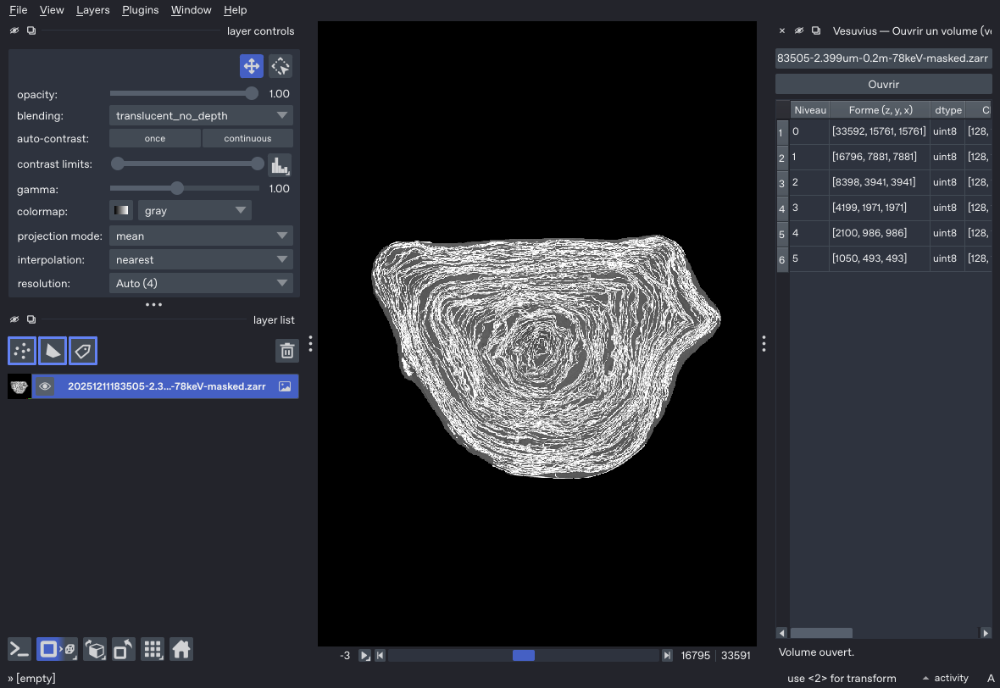

# T2 — Vérification sur un volume réel

Validation du 17 novembre 2026 sur un affichage Xorg natif, Python 3.12.14,
napari 0.10.0 et PyQt6 6.12.1. La contribution npe2 du plugin a été ouverte,
son champ de chemin renseigné et son bouton **Ouvrir** activé.

## Source et provenance

URI effectivement ouverte :

```text
s3://vesuvius-challenge-open-data/PHerc0332/volumes/20251211183505-2.399um-0.2m-78keV-masked.zarr
```

Le [dépôt officiel Open Data](https://github.com/ScrollPrize/open-data) documente le
bucket et le sample PHerc0332. Son ancien exemple `20231201141544` n'existe plus.
L'URI ci-dessus provient du listing public anonyme de `PHerc0332/volumes`, puis a été
vérifiée par lecture des métadonnées et d'une ROI centrale 64×64 au niveau 5.
Elle n'a pas été construite à partir d'un nom d'artefact supposé.

Données CT : Vesuvius Challenge, *CT Scans of Herculaneum Papyri* (2026),
[documentation et citation](https://github.com/ScrollPrize/open-data#support-and-citation).
La capture contient un extrait de ces données, distribué sous
[CC BY-NC 4.0](https://creativecommons.org/licenses/by-nc/4.0/), conformément à la source ;
la licence MIT du code ne change pas la licence des données dans cette image.

## Résultat visible



Inspection visuelle : une coupe du rouleau est affichée, sur **un seul calque Image**
scalaire multi-échelles avec **6 niveaux**. Le tableau des métadonnées est rempli et
le statut indique « Volume ouvert. ». L'échelle du calque est `(1, 1, 1)` dans le repère
de ce volume ; le contraste explicite est `(0, 122)`. Ces unités ne sont pas assimilées
à des micromètres sans les métadonnées correspondantes.

## Temps et navigation 2D

- Métadonnées seules lors de la vérification préalable : **11,742 s**.
- Ajout du calque après le clic dans le widget : **30,577 s**.
- Première image effectivement visible et capturée : **64,047 s**.
- Séquence de zoom ×1,5, déplacement de 300 voxels sur Y/X, zoom ×2 et retour à la vue
  initiale, pilotée par l'API native de la caméra.
- Les opérations déjà en cache sont revenues dans les fenêtres d'observation d'environ
  **0,9 s**. Le zoom ×2 nécessitant une nouvelle résolution a attendu **25,723 s**.
- Le timer Qt de 20 ms a présenté un intervalle p95 de **56,35 ms** et un maximum de
  **3,021 s**, captures et rendu compris. Ce timer mesure la réactivité de la boucle Qt,
  pas la fréquence d'images.

La navigation reste utilisable pendant les chargements asynchrones, mais les nouveaux
chunks S3 introduisent une latence sensible sur cette connexion. Ce constat ne constitue
pas une promesse de navigation instantanée sur un volume distant. La capture et les
valeurs détaillées sont conservées dans [t2-real-volume.json](t2-real-volume.json).
Il s'agit d'une vérification visuelle et d'une navigation scriptée sur une vraie fenêtre,
pas d'un test manuel à la souris sur un poste utilisateur.

Les tests du store instrumenté concernent la **préparation** des données du lecteur et
le contraste : seuls les chunks de la ROI centrale du niveau le plus grossier sont lus.
Le rendu par napari lit ensuite les chunks nécessaires à la résolution affichée, puis
les changements de zoom peuvent demander des niveaux plus fins. Aucun volume complet
n'a été matérialisé pour cette vérification.

## Reproduire

```bash
python -m pip install -e '.[napari]'
napari -w vesuvius-data-explorer
```

Coller l'URI exacte ci-dessus dans le widget, cliquer sur **Ouvrir**, puis zoomer et déplacer
la vue 2D. Le test réseau de métadonnées est également passé avec cette URI via
`VESUVIUS_TEST_ZARR` : `1 passed, 66 deselected in 13.85s` sur le cœur T1.1 validé.
