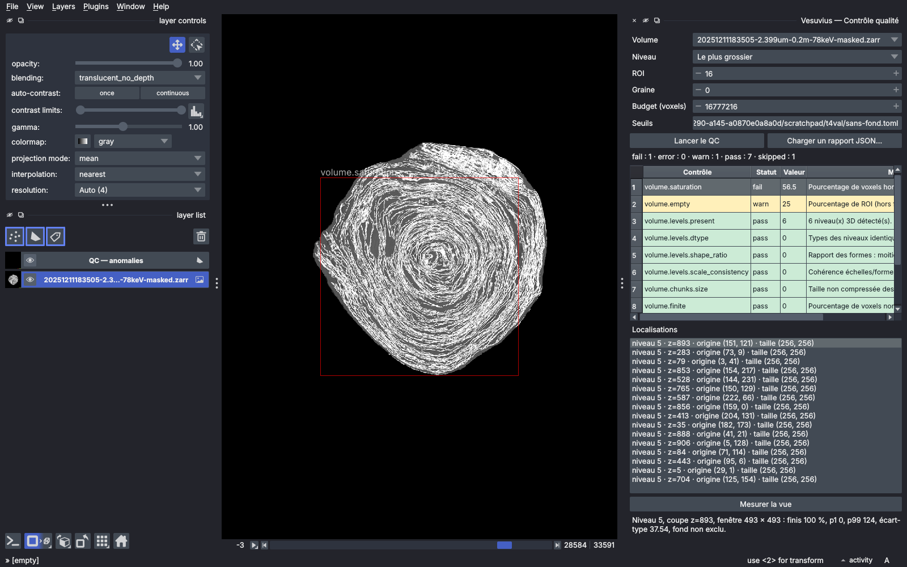

# T4 — Contrôle qualité dans napari sur un volume réel

Validation du 17 novembre 2026, napari 0.10.0, PyQt6 6.12.1, affichage virtuel Xvfb 1920×1080.
Exécution **scriptée** du vrai widget (clics programmatiques sur ses boutons, sélection dans son
tableau), pas un test manuel à la souris. Préférences napari isolées (`NAPARI_CONFIG` temporaire),
chargement asynchrone activé explicitement.

Volume : `s3://vesuvius-challenge-open-data/PHerc0332/volumes/20251211183505-2.399um-0.2m-78keV-masked.zarr`
(URI vérifiée en T2). Données : Vesuvius Challenge, *CT Scans of Herculaneum Papyri* (2026),
[documentation et citation](https://github.com/ScrollPrize/open-data#support-and-citation). La
capture contient un extrait de ces données, sous
[CC BY-NC 4.0](https://creativecommons.org/licenses/by-nc/4.0/) ; la licence MIT du code ne
s'applique pas à cette image.

## 1. QC sans exclusion du fond : des anomalies à trouver

Fichier de seuils `["volume.background"] enabled = 0`, niveau le plus grossier (5), 16 ROI, graine 0.

- Durée : **6,7 s**. Résumé : 7 pass, 1 warn, 1 fail, 1 skipped.
- `volume.saturation` **fail, 56,5 %** et `volume.empty` **warn, 25 %** : ce sont les voxels de
  fond à 0, comptés comme saturés quand l'exclusion est désactivée (comportement attendu, cf. T3).
- Calque « QC — anomalies » : **20 rectangles**, un par localisation.

## 2. Navigation

Sélection de `volume.saturation`, puis de sa première localisation (niveau 5, z = 893, origine
(151, 121), taille 256 × 256) :

- coupe affichée z = 28 584 en coordonnées monde : rapport des formes 33 592 / 1 050 ≈ 31,99
  (et non exactement 32), centre du voxel 893 du niveau 5 = ⌊893 × 31,99 + 15,5⌋ = 28 584 au
  niveau 0. C'est le même rapport des formes que napari utilise pour ses niveaux multi-échelles ;
  les échelles OME (×32) donneraient un écart de 8 voxels à cette profondeur ;
- caméra centrée dans le rectangle, zoom réglé pour qu'il occupe la moitié de la vue ;
- rendu de la nouvelle coupe : **2,1 s**.

Le rectangle rouge recouvre bien du **fond noir hors du rouleau**, ce qui explique l'anomalie. Il
recouvre aussi une partie du rouleau : au niveau 5, une ROI de 256 × 256 couvre près de la moitié
de la coupe. **Pour une localisation fine, lancer le QC sur un niveau plus fin** (champ « Niveau »).

## 3. Mesurer la vue

Sur la vue de la capture : niveau 5, z = 893, fenêtre 493 × 493 (≤ 512²), 100 % de valeurs finies,
p1 0, p99 124, écart-type 37,54 ; « fond non exclu » car le fichier de seuils sans fond était encore
sélectionné.

## 4. QC avec la configuration par défaut

Même volume, mêmes paramètres, sans fichier de seuils : **10 pass**, **0 rectangle**, durée 5,2 s.
Relancer a remplacé le calque d'anomalies au lieu d'en ajouter un.

## Constats pour la suite

- Le **contraste initial** (estimé en T2 sur une coupe qui contient le fond à 0) donne une image très
  contrastée : p1 vaut 0 à cause du fond. L'estimation du contraste devrait exclure le fond, comme le
  QC (proposé pour T6).
- Ouverture du volume : 5,9 s cette fois-ci (64 s lors de la validation T2, autre réseau) : la
  latence S3 varie fortement selon la connexion.

Détails chiffrés : [`t4-validation.json`](t4-validation.json).
