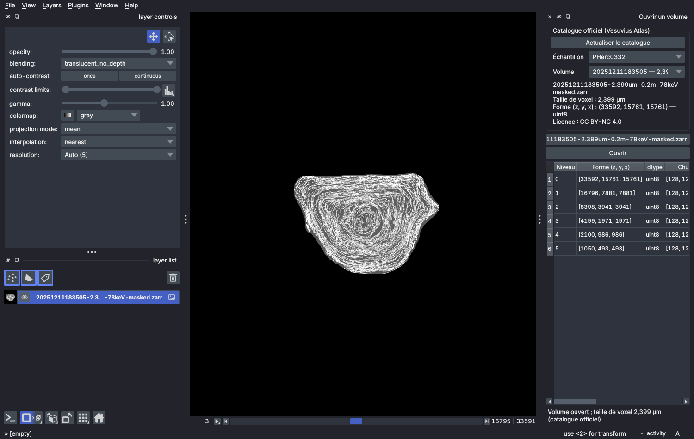

# T4.2 — Sélecteur de catalogue sur les vraies données

Validation du 17 novembre 2026, napari 0.10.0, PyQt6 6.12.1, zarr 3.4.2, Xvfb 1600×1000. Exécution
**scriptée** du vrai widget (appels de ses actions, sélection dans ses listes), pas un test manuel à
la souris. Préférences napari isolées, chargement asynchrone activé explicitement, cache du
catalogue dans un dossier temporaire.

## 1. Catalogue

`s3://vesuvius-challenge-open-data/metadata.json`, version du 16 novembre 2026 (9,3 Mo servis en
gzip) :

- premier chargement **1,4 s** (téléchargement et lecture), puis **0,2 à 0,4 s** depuis le cache ;
- **82 copies ouvrables** dans **39 échantillons** : 67 standard en S3, 7 standard en HTTPS
  (`data.aws.ash2txt.org`), 8 `vc-delta3d` ; les 6 autres échantillons n'ont pas de volume publié.
  Les 3 volumes publiés à la fois en S3 et en HTTPS apparaissent une fois, en S3.

## 2. Ouverture depuis le sélecteur

| Échantillon | Volume | Accès | Voxel | Ouverture | Message |
|---|---|---|---|---|---|
| PHerc0332 | `20251211183505` | S3 | 2,399 µm | 5,8 s | ouvert, aucun avertissement |
| PHercParis4 | `20230205180739` (Scroll 1) | HTTPS | 7,91 µm | 3,4 s | ouvert, **avertissement de forme** |

La capture contient un extrait des données PHerc0332 : Vesuvius Challenge, *CT Scans of Herculaneum
Papyri* (2026), [citation](https://github.com/ScrollPrize/open-data#support-and-citation),
[CC BY-NC 4.0](https://creativecommons.org/licenses/by-nc/4.0/) ; la licence MIT du code ne
s'applique pas à cette image. Scroll 1 relève de l'*EduceLab Data License* : pas de capture ici.

## 3. Constat : forme du catalogue différente des données pour Scroll 1

Comparaison de la forme annoncée par le catalogue et de celle du niveau 0 réel, pour les 74 copies
standard (66 issues du recensement I1, 8 HTTPS ouvertes pour cette validation) :

- **69 identiques** ;
- **4 sans forme** dans le catalogue (PHerc0500P2 × 3, PHerc0343P) ;
- **1 différente : Scroll 1** (`20230205180739`) : catalogue (14 369, 7 888, 8 096), données
  **(14 258, 7 888, 8 096)**, soit 111 coupes z de moins.

**Cause identifiée (audit du 18 novembre 2026).** La même fiche décrit un recadrage en z
(`z_crop_start = 0`, `z_crop_end = 14 257`), soit exactement 14 258 coupes : le volume publié est
recadré et le champ `shape` donne la forme d'avant recadrage. Pour les deux autres volumes recadrés
du catalogue, `shape` vaut bien `z_crop_end + 1`. Le schéma du catalogue indique que `shape` est
« relevé à l'ingestion » et que les métadonnées Zarr font foi. Il s'agit donc d'une **incohérence
mineure de la fiche**, pas de données manquantes. Une conséquence pratique : une coordonnée z issue d'un outil qui se fie au catalogue peut ne pas
exister dans le volume publié. L'avertissement du widget rend cet écart visible au lieu de le taire.
À signaler aux mainteneurs du catalogue si le PO le souhaite.
