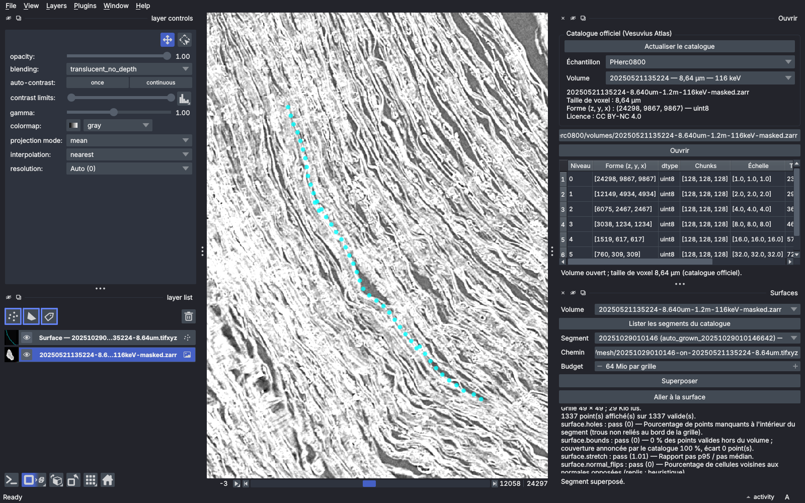
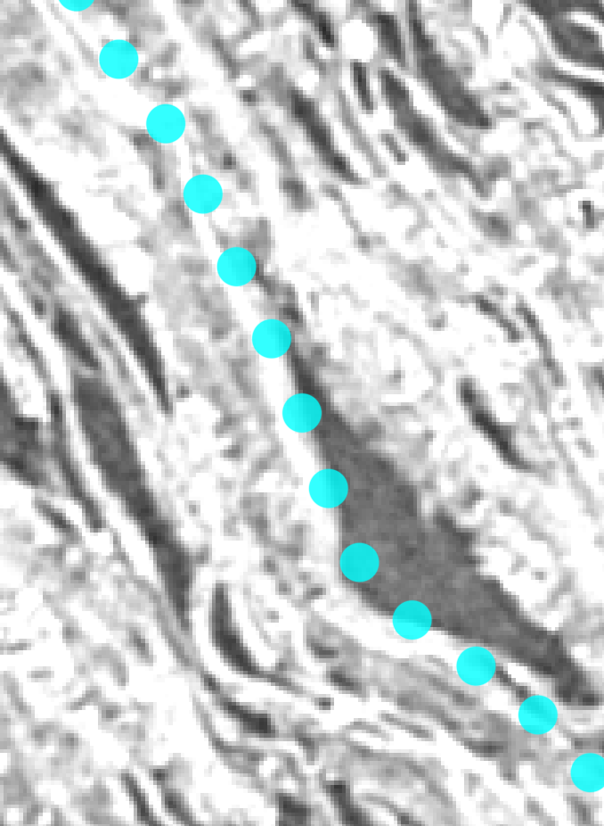

# T5 — Surfaces VC3D sur les vraies données

Validation du 17 novembre 2026, napari 0.10.0, PyQt6 6.12.1, Xvfb 1600×1000. Exécution **scriptée**
des vrais widgets (actions et sélections programmatiques), pas un test manuel à la souris.
Catalogue officiel du 16 novembre 2026.

## 1. Superposition dans napari

Volume PHerc0800 `20250521135224` (8,64 µm, S3), choisi dans le catalogue ; segment
`20251029010146` (`auto_grown_20251029010146642`), copie transformée vers ce volume, proposé parmi
les 6 segments publiés dans son repère.

- Lecture du segment et indicateurs : **1,5 s** (grille 49 × 49, 29 Kio lus).
- Indicateurs : `surface.holes` pass (0 %), `surface.bounds` pass (0 % hors volume, couverture du
  catalogue 100 %), `surface.stretch` pass (1,01), `surface.normal_flips` pass (0 %),
  `surface.valid` 55,7 % (informatif : contour irrégulier).
- **Aller à la surface** : coupe z = 12 058, vue cadrée sur le segment.

Agrandissement × 5 au centre de la trace :

**Lecture :** sur cette coupe, la trace suit le bord d'une feuille claire, le long d'un espace
sombre entre deux couches. C'est ce qu'on attend d'un segment qui suit une surface de papyrus. Ce
n'est pas une preuve d'alignement en tout point : l'indicateur quantitatif est l'objet de T5.1.

Les captures contiennent des extraits des données PHerc0800 : Vesuvius Challenge, *CT Scans of
Herculaneum Papyri*, [citation](https://github.com/ScrollPrize/open-data#support-and-citation),
[CC BY-NC 4.0](https://creativecommons.org/licenses/by-nc/4.0/) ; la licence MIT du code ne
s'applique pas à ces images.

### Écart à la spécification : affichage de la trace

La spécification prévoyait l'option napari `out_of_slice_display`. Dans napari 0.10, elle est
dépréciée et n'affiche plus que les points exactement sur la coupe : un seul point visible lors du
premier essai. Son remplaçant, le « thick slicing », s'applique à tout le visualiseur et moyenne
aussi l'image (projection `mean` par défaut). La trace est donc calculée par le plugin : à chaque
changement de coupe, les points à moins d'un demi-pas de grille sont placés sur la coupe ; en 3D,
tous les points sont affichés.

## 2. Indicateurs sur 30 segments réels

28 segments tirés au hasard (graine 7) parmi les copies transformées actuelles de moins de 64 Mio
par grille, plus 2 entre 64 et 160 Mio. Formes des volumes prises dans le catalogue. Données
brutes : [`t5-segments.json`](t5-segments.json).

| Indicateur | Résultat |
|---|---|
| `surface.valid` | 36,7 à 92,4 % : un taux bas ne signale **pas** un défaut (contours irréguliers) |
| `surface.holes` | 29 pass (0 à 0,83 %), **1 warn** : PHerc0814 `20250925182632`, 3,75 %, au moins 20 trous |
| `surface.stretch` | 1,00 à 1,15 : 30 pass |
| `surface.normal_flips` (local) | 0 à 0,33 % : 30 pass |
| `surface.bounds` | 27 pass, **1 warn** (voir ci-dessous), 2 skipped (forme absente du catalogue) |

**Écart à la spécification : replis.** Avec la mesure d'avant T5 (comparaison de chaque normale à
la normale médiane), **27 segments sur 30** dépassaient 27 % (26 entre 42 et 53 %) et auraient
échoué. Une feuille enroulée dans le rouleau a des normales dans toutes les directions : la mesure
signalait la courbure, pas des replis. Elle compare désormais les **cellules voisines** ; un repli
apparaît comme une couture de normales opposées. Seuils provisoires : warn 0,5 %, fail 2 % (un repli
franc dans une grille de test de 64 × 64 donne 0,8 %).

**Couverture.** L'écart entre la part de points dans le volume et `overlap_ratio` du catalogue reste
sous 1,7 point, sauf pour un segment de PHercParis4 sur Scroll 1 (`20260701183145`) : 2,2 points.
Ce volume est celui dont la forme du catalogue diffère des données (constat de T4.2) ; la
tolérance de 2 points est conservée.

**Lecture décimée.** Les 2 segments de plus de 64 Mio par grille (2 432 × 9 332 et 2 488 × 10 340)
ont été lus une ligne et une colonne sur 2, dans le budget, en 50 s environ chacun.

**Durées.** 0,8 à 7,5 s par segment, sauf un segment de 16,6 Mio par grille (50 s) : 6 lectures
étaient menées en parallèle et le débit S3 de l'environnement de validation était d'environ
1 Mio/s par lecture. Elles dépendent surtout du réseau.
