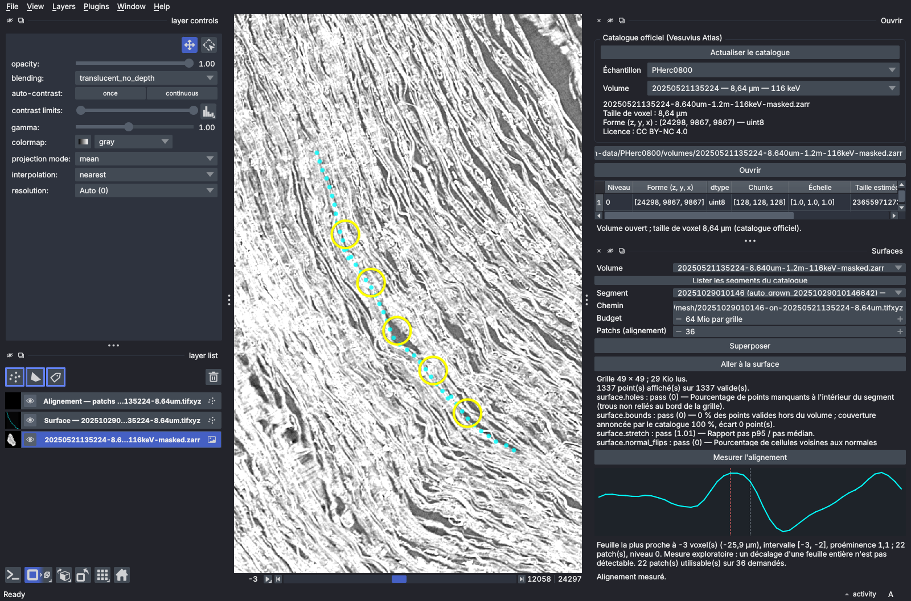

# T5.1 — Alignement surface–volume : calibration sur données réelles

Validation du 17 novembre 2026 selon le protocole de la
[spécification](../tasks/T5.1-alignement-surface-volume.md).

- Script : [`T5.1_calibration.py`](T5.1_calibration.py).
- Données brutes : [`t5.1-calibration.json`](t5.1-calibration.json) (36 patchs, réglage retenu),
  [`t5.1-calibration-12-patchs.json`](t5.1-calibration-12-patchs.json) et
  [`t5.1-calibration-36-normalise.json`](t5.1-calibration-36-normalise.json).

## Conclusion

Avec **36 patchs** au lieu des 12 prévus par la spécification, les deux critères du protocole
sont atteints :

| Critère du protocole | Seuil | 12 patchs (spécification) | **36 patchs (retenu)** |
|---|---|---|---|
| Récupération d'un décalage de ±25 µm | ≥ 80 % | 69 % (29 / 42) | **88 %** (37 / 42) |
| Séparation : cas incohérents moins proéminents que le segment publié | ≥ 90 % | 95 % (20 / 21) | **90 %** (19 / 21) |

**Réglage par défaut modifié** : 36 patchs (réglable dans napari), budget de 80 Mi-voxels.
**`surface.alignment` reste informatif** : la spécification réserve au PO la décision de noter
(section 5).

## 1. Échantillon et conditions

- **21 segments** `tifxyz-transformed` actuels, de moins de 64 Mio par grille, tirés avec la
  graine 11, en **3 classes de résolution** :
  - 7 à environ 8 µm : 7,91, 8,64 et 9,362 µm, profil lu au niveau 0 ;
  - 7 à environ 2,4 µm : 2,399 à 2,403 µm, niveau 2 ;
  - 7 à 1,129 µm : niveau 3.
- Pour chaque segment, 6 mesures :
  - le segment publié ;
  - le segment décalé le long de ses normales de +25, −25, +50 et −50 µm ;
  - un décalage aléatoire indépendant par patch, de ±50 µm au plus (cas incohérent).
- Patchs de 6 × 6 points, portée ±200 µm, voxel de lecture ≤ 10 µm.
- **Récupération** : le pic mesuré après un décalage imposé doit tomber à 2 pas d'échantillonnage
  près de « pic publié − décalage ».
- Aucune erreur, sur aucun des passages.

## 2. Passages de calibration

| Passage | Récupération ±25 µm | ±50 µm | Séparation | Voxels lus (médiane) | Durée par mesure |
|---|---|---|---|---|---|
| 12 patchs, budget de 8 Mi-voxels (spécification) | 69 % | — | 86 % | 4 à 7 patchs lus sur 12 | — |
| 12 patchs, budget suffisant | 69 % | 69 % | 95 % | 17 Mi | ≈ 12 s |
| 12 patchs, profils normalisés par patch | 71 % | 71 % | 86 % | 17 Mi | ≈ 12 s |
| **36 patchs** | **88 %** | **88 %** | **90 %** | **52 Mi** (65 Mi au plus) | **≈ 42 s** |
| 36 patchs, profils normalisés | 90 % | 86 % | 90 % | 52 Mi | ≈ 43 s |

- **Écart 1, budget.** Le budget prévu par la spécification (8 Mi-voxels) arrêtait la plupart des
  mesures après 4 à 7 patchs sur 12 : la boîte lue autour d'un patch oblique est grande.
- **Écart 2, nombre de patchs.** C'est le **nombre de patchs** qui améliore la mesure. Normaliser
  les profils n'apporte rien : 71 % avec 12 patchs, et un résultat équivalent avec 36. Le réglage
  retenu est donc 36 patchs, sans normalisation.
- **Coût.** Une mesure prend environ 42 s depuis S3 dans l'environnement de validation, contre
  12 s avec 12 patchs. Elle s'exécute dans un thread de travail ; le nombre de patchs reste réglable
  dans napari.
- **Petits segments.** Un segment trop petit pour 36 patchs utilise tous ses patchs utilisables
  (22 pour PHerc0800 `20251029010146`) et le signale.

## 3. Résultats avec 36 patchs

**Récupération par classe**, décalages de ±25 µm : ~8 µm 12 / 14 ; ~2,4 µm 12 / 14 ; ~1,1 µm 13 / 14.

**Position du pic sur les segments publiés**, en µm le long de la normale (proéminence entre
parenthèses) :

- ~8 µm : −8,6 (0,31) ; −9,4 (2,98) ; 0,0 (0,77) ; −25,9 (1,07) ; −9,4 (0,48) ; −18,7 (1,23) ;
  0,0 (0,09) ;
- ~2,4 µm : −19,2 (0,12) ; −9,6 (1,18) ; −19,2 (0,76) ; −9,6 (0,50) ; −48,1 (0,70) ; −28,8 (0,56) ;
  0,0 (0,70) ;
- ~1,1 µm : −9,0 (1,37) ; −9,0 (1,34) ; −9,0 (0,46) ; −18,1 (0,20) ; 99,3 (0,13) ; −9,0 (0,79) ;
  −9,0 (2,23).

La médiane vaut **−9,4 µm**, et 19 segments sur 21 se trouvent entre −30 et +10 µm. Les surfaces
VC3D sont proches de la feuille, avec un léger biais du même côté, ce qui est cohérent avec un
segment qui suit une face de la feuille plutôt que son centre. La seule valeur aberrante
(99,3 µm) a une proéminence très faible (0,13) : la mesure n'y trouve pas de feuille nette.

**Fiabilité selon la proéminence :**

| Proéminence du segment publié | Segments | Récupération ±25 µm | Cas incohérents au-dessus du seuil |
|---|---|---|---|
| toutes | 21 | 88 % | 21 / 21 |
| ≥ 1,0 | 7 | 100 % | 1 / 21 |
| ≥ 1,3 | 4 | 100 % | 0 / 21 |

## 4. Dans napari

Volume PHerc0800 `20250521135224`, segment `20251029010146` :

- mesure en **18,3 s** ;
- feuille la plus proche à **−3 voxels (−25,9 µm)**, intervalle bootstrap [−3, −2], proéminence
  1,1 ;
- 22 patchs utilisables sur 36, niveau 0.

Extrait des données PHerc0800 : Vesuvius Challenge, *CT Scans of Herculaneum Papyri*,
[citation](https://github.com/ScrollPrize/open-data#support-and-citation),
[CC BY-NC 4.0](https://creativecommons.org/licenses/by-nc/4.0/) ; la licence MIT du code ne
s'applique pas à cette image.

## 5. Options pour le PO

1. **Garder `surface.alignment` informatif** (état actuel). Le message donne le décalage, l'intervalle
   bootstrap et la proéminence.
2. **Noter les décalages manifestes** : `warn` si |décalage| dépasse un seuil, par exemple 40 µm,
   soit environ 4 fois la médiane observée. Ce seuil n'est pas calibré : les segments publiés
   n'offrent pas d'exemple de défaut d'alignement réel ; seuls les décalages imposés en tiennent
   lieu.
3. **Avant de noter, recalibrer sur un second échantillon** de 20 segments, pour confirmer les 88 %
   hors de l'échantillon qui a servi à choisir les 36 patchs.

Dans tous les cas, un saut d'une feuille entière reste indétectable par cette mesure.
