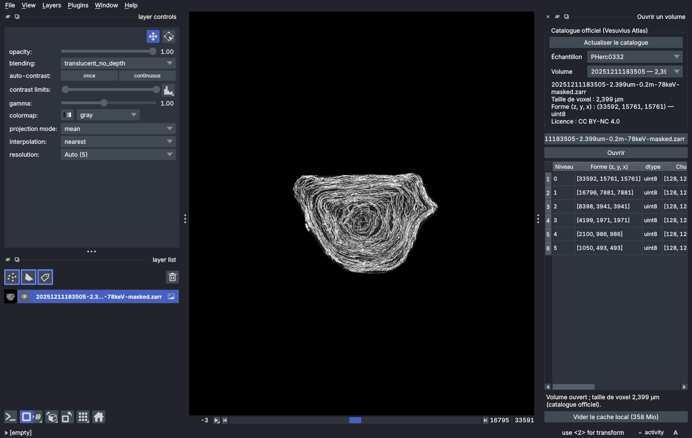

# T6 — Performance S3 : mesures avant et après

Validation du 18 novembre 2026, napari 0.10.0, environnement cloud à 4 cœurs, volume PHerc0800
`20250521135224` (8,64 µm, chunks de 128³ non compressés). Exécution **scriptée** des vrais
widgets ([`T6_bench_napari.py`](T6_bench_napari.py)). La version « avant » est `main` au commit
8401e20 ; la version « après » est la branche T6, d'abord avec un cache vide, puis dans une nouvelle
session avec le cache déjà rempli.

## Résultats

| Opération | Avant | Après, cache vide | Après, cache rempli (nouvelle session) |
|---|---|---|---|
| Ouverture (métadonnées et contraste) | 4,98 s | 3,72 s | 2,80 s |
| Première vue 2D au niveau 0 | 2,96 s | 3,24 s | 0,67 s |
| **Coupe suivante** | 0,77 s | **0,46 s** | **0,20 s** |
| 10 coupes suivantes | 7,24 s | 2,64 s | 2,50 s |
| **Mesure d'alignement** (22 patchs) | 21,1 s | **4,5 s** | **0,70 s** |
| Même mesure relancée | 21,0 s | 0,61 s | 0,66 s |

**Objectifs de la spécification :**

| Objectif | Résultat | Atteint |
|---|---|---|
| Mesure d'alignement à froid au moins 3 fois plus rapide | 21,1 s → 4,5 s, soit 4,7 fois | oui |
| Coupe suivante en cache sous 0,5 s | 0,46 s (cache vide), 0,20 s (cache rempli) | oui |

- La première vue d'une région jamais lue reste limitée par S3 : environ 3 s pour les 64 chunks
  (128 Mio) d'une vue de niveau 0. Le cache sert aux relectures.
- Taille du cache après ces trois sessions : **334 Mio**, pour une région et un segment.
- Les 10 coupes suivantes prennent encore 0,25 s chacune avec le cache rempli : cela correspond au
  décodage depuis le disque et au rendu napari, plus au réseau.

## Contraste initial

| Volume masqué | Avant | Après |
|---|---|---|
| PHerc0800 `20250521135224` | (0, 121) | **(12, 128)** |
| PHerc0332 `20251211183505` | (0, 122) | **(31, 132)** |
| PHercParis4 `20230205180739` (Scroll 1, HTTPS) | (0, 109) | **(14, 112)** |

À comparer avec la [capture de T4.2](t4.2-catalogue-pherc0332.png) : les espaces entre les feuilles
sont noirs et les feuilles se détachent. Extrait des données PHerc0332 : Vesuvius Challenge,
*CT Scans of Herculaneum Papyri*,
[citation](https://github.com/ScrollPrize/open-data#support-and-citation),
[CC BY-NC 4.0](https://creativecommons.org/licenses/by-nc/4.0/) ; la licence MIT du code ne
s'applique pas à cette image.

## Écarts à la spécification

1. **Valeur de fond du contraste.** Elle est fixée à 0, la valeur par défaut des seuils QC, et
   modifiable par le paramètre `background` de `estimate_contrast`. Le widget d'ouverture n'a pas de
   champ « fichier de seuils » ; le brancher n'a pas paru utile tant que tous les volumes masqués
   publiés utilisent 0.
2. **Écritures concurrentes dans le cache.** Elles n'ont pas été testées entre deux sessions
   napari : `CacheStore` écrit par clé dans un `LocalStore`, sans verrou. Le risque est limité à une
   relecture depuis la source si une entrée est incomplète. Point à surveiller.

## Vérifications

- Le cache fonctionne avec zarr 3.4.2 et avec zarr 3.1.6, la version installée par la CI en
  Python 3.11.
- Le cache de fsspec (`filecache::`) a été écarté : il échoue avec les lectures concurrentes de
  Zarr 3 (erreur de boucle d'événements).
