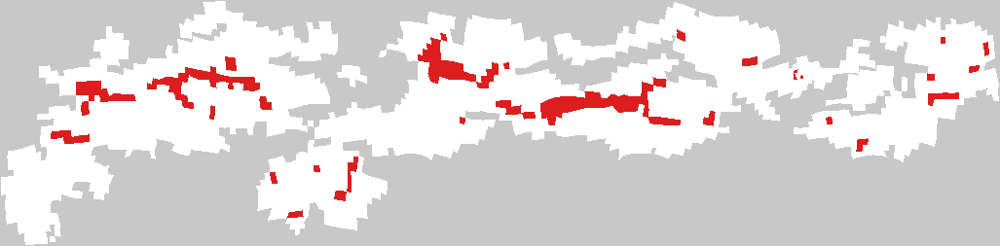

# T7 — Contrôle qualité en lot sur un vrai volume

Validation du 18 novembre 2026, environnement cloud à 4 cœurs, cache vide au départ.

```bash
vesuvius-qc lot 20250804134230 -o PHerc0814
```

Volume PHerc0814 `20250804134230` (9,362 µm), 19 segments publiés dans son repère. Synthèse :
[`t7-PHerc0814-synthese.html`](t7-PHerc0814-synthese.html) (et
[JSON](t7-PHerc0814-synthese.json)).

- **Durée : 106 s** pour les 19 segments, alignement compris ; 2 Gio de cache à la fin.
- **Résultat : 6 `fail`, 6 `warn`, 7 `pass`.** Toutes les alertes viennent de `surface.holes`.
  Bornes, étirement, replis et alignement sont `pass` pour les 19 segments.

| Contrôle | pass | warn | fail |
|---|---|---|---|
| `surface.holes` | 7 | 6 | 6 |
| `surface.bounds`, `surface.stretch`, `surface.normal_flips`, `surface.alignment` | 19 | 0 | 0 |

**Constat.** Les 12 segments signalés sont tous des segments `auto_grown` de septembre 2025, avec
2,3 à 8,3 % de points manquants à l'intérieur. Les 7 segments de février 2026 n'en ont aucun.



Vérification visuelle sur le pire segment (`20250930083742`, 8,3 %) : 36 trous, 8 685 points,
taille médiane 76 points, le plus grand 2 279. Ce sont des **brèches allongées entre des zones
remplies**, pas du bruit isolé (5 trous seulement font un point). L'indicateur signale donc un vrai
défaut de couverture de ces segments ; c'est cohérent avec la croissance automatique, qui laisse
des zones non remplies entre ses fronts.
